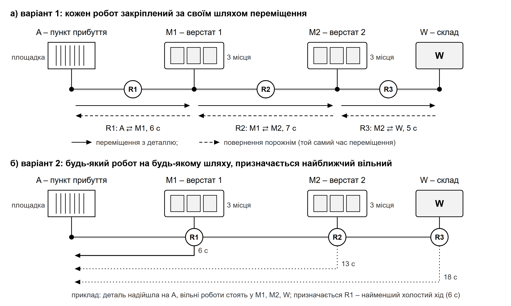
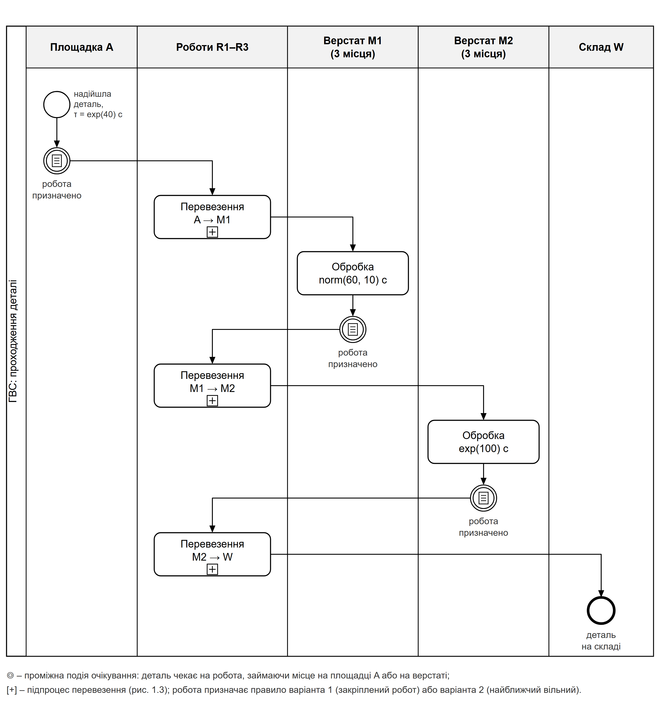
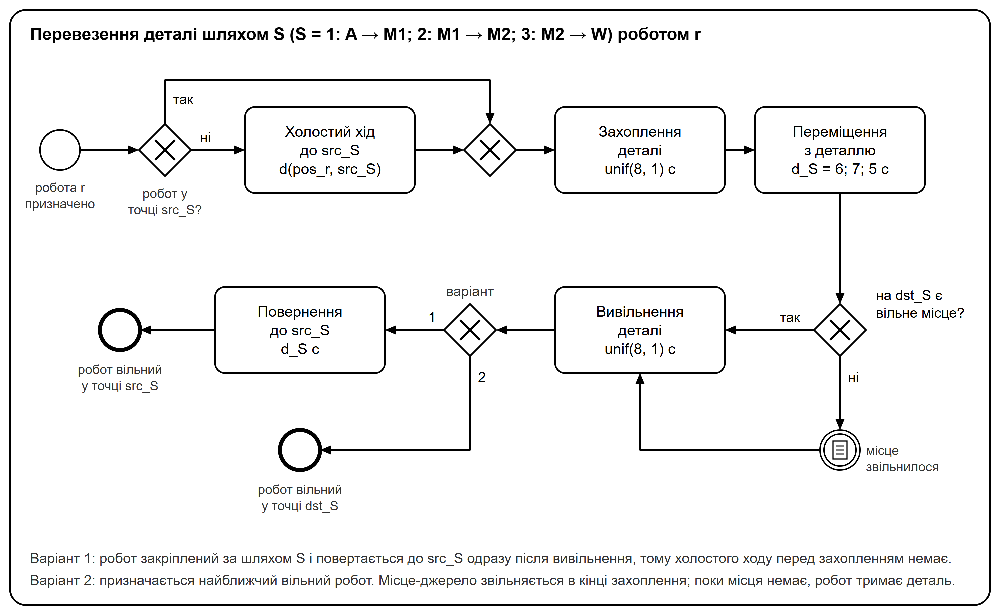

# 1 КОНЦЕПТУАЛЬНА МОДЕЛЬ СИСТЕМИ

Концептуальна модель системи – це деталізований опис складових елементів системи, правил їх взаємодії та процесу, який моделюється, разом із зазначенням мети моделювання [@mk, с. 49]. За умовою завдання потрібно порівняти два способи закріплення роботів. Якщо завдання передбачає альтернативні моделі, концептуальний опис розробляють для кожної з них [@mk, с. 50]. Тому спільні елементи і процес описано один раз, а відмінності – окремо для кожного варіанта.

## 1.1 Мета моделювання

Об'єктом моделювання є експериментальна роботизована гнучка виробнича система (ГВС), що складається з двох верстатів із числовим програмним керуванням, трьох роботів, пункту прибуття деталей і складу оброблених деталей.

Метою моделювання є визначення найкращого з погляду пропускної здатності ГВС способу закріплення роботів до операцій переміщення деталей. Розглядаються два способи:

1) варіант 1 – по одному роботу на кожному з трьох шляхів переміщення деталей: пункт прибуття – перший верстат, перший верстат – другий верстат, другий верстат – склад;
2) варіант 2 – кожен робот може виконувати переміщення на будь-якому шляху, при цьому на перевезення призначається найближчий з вільних роботів.

Для кожного варіанта потрібно визначити:

- пропускну здатність ГВС, тобто кількість деталей, що надходять на склад за одиницю часу;
- розподіл часу проходження деталей через систему;
- коефіцієнти використання роботів і верстатів;
- максимальну місткість місця зберігання деталей на ділянці прибуття.

## 1.2 Складові елементи системи

За текстом завдання виділено такі елементи ГВС:

1) деталі – об'єкти обробки; вони надходять на пункт прибуття в середньому кожні 40 с, інтервали між надходженнями розподілені за експоненціальним законом;
2) пункт прибуття A з місцем зберігання (площадкою), на якому деталі очікують на робота; кількість місць на площадці не обмежена, а її найбільше заповнення є однією з шуканих характеристик;
3) верстати M1 і M2 з числовим програмним керуванням; кожен із них одночасно обробляє до трьох деталей, тобто має три місця обробки; час обробки на M1 розподілений за нормальним законом із середнім 60 с і стандартним відхиленням 10 с, на M2 – за експоненціальним законом із середнім 100 с;
4) три роботи R1, R2, R3, які захоплюють деталь, переміщують її між пунктами і вивільняють; захоплення і вивільнення триває 8 ± 1 с;
5) склад оброблених деталей W, на якому деталь залишає систему.

Час переміщення робота між пунктом прибуття і першим верстатом, першим і другим верстатом, другим верстатом і складом становить відповідно 6, 7 і 5 с і однаковий для руху з деталлю і порожнім. Схему розташування обладнання та закріплення роботів для обох варіантів наведено на рисунку 1.1.

## 1.3 Опис процесу функціонування системи

Деталь, що надійшла на пункт прибуття, залишається на площадці, доки її не захопить робот. Перевезення деталі між двома пунктами складається з таких дій робота:

1) захоплення деталі; місце, яке займала деталь, звільняється після завершення захоплення;
2) переміщення з деталлю до пункту призначення;
3) очікування з деталлю, якщо на верстаті-приймачі немає вільного місця; робот тримає деталь і не може виконувати інших перевезень, доки місце не звільниться;
4) вивільнення деталі; місце верстата зайняте вже під час вивільнення, а після його завершення на верстаті починається обробка.

Оброблена на верстаті деталь залишається на своєму місці, доки її не захопить робот. Поки деталь чекає на робота, місце верстата зайняте і нова деталь на нього потрапити не може. Після обробки на M1 деталь перевозиться на M2, після обробки на M2 – на склад, де вона залишає систему.

Варіанти відрізняються правилом призначення робота на перевезення і тим, що робот робить після вивільнення деталі:

- у варіанті 1 кожен робот обслуговує лише свій шлях: R1 – A ⇄ M1, R2 – M1 ⇄ M2, R3 – M2 ⇄ W. Робот везе деталь у прямому напрямку, а після вивільнення одразу повертається порожнім до стартової точки свого шляху і стає вільним лише там. Тому наступну деталь він захоплює без холостого ходу, якщо вона надійшла після його повернення;
- у варіанті 2 будь-який вільний робот може виконати будь-яке перевезення, і на перевезення призначається найближчий з вільних роботів, тобто той, холостий хід якого до точки завантаження найменший. Робот рухається порожнім до деталі, коли його призначено, а після вивільнення залишається в пункті вивантаження. Якщо однаково близько стоять кілька вільних роботів, вони стоять в одній точці і рівноцінні, тому обирається будь-який з них.

У варіанті 2 правило призначення найближчого робота доповнено умовою, без якої система зупиняється. Робот не бере деталь для верстата, до якого вже везуть деталі на одного робота більше, ніж там вільних місць. Кількість роботів не змінюється, їх три за умовою: умова лише визначає, коли вільний робот може взяти деталь. Без неї всі три роботи можуть узяти деталі для одного заповненого верстата й чекати біля нього, а оброблені деталі на цьому верстаті не матимуть вільного робота, і система зупиниться (підрозділ 2.3). У варіанті 1 до кожного верстата їздить лише один закріплений робот, тож така ситуація неможлива.

Під час розробки моделі прийнято такі припущення:

1) пункти розташовані на одній лінії A – M1 – M2 – W, тому час переміщення між несусідніми пунктами дорівнює сумі часів між сусідніми: A – M2 становить 13 с, M1 – W 12 с, A – W 18 с;
2) у варіанті 2 після вивільнення деталі робот залишається в пункті вивантаження;
3) час обробки на M1 не може бути від'ємним, тому від'ємні значення нормального закону відкидаються; ймовірність такого значення менша за $10^{-9}$;
4) якщо на площадці A або на верстаті робота чекають кілька деталей, першою перевозиться та, що стала готовою до перевезення раніше;
5) події, що відбуваються одночасно, виконуються у випадковому порядку;
6) у початковий момент система порожня, а роботи стоять у точках завантаження своїх шляхів варіанта 1: R1 – в A, R2 – в M1, R3 – в M2; для варіанта 2 прийнято той самий початковий стан, щоб варіанти порівнювались за рівних умов.

Процес проходження деталі через ГВС у нотації BPMN [@bpmn] наведено на рисунку 1.2. Перевезення деталі на діаграмі є підпроцесом, однаковим для всіх трьох шляхів. Його розгорнуто на рисунку 1.3.

{width=92%}

## 1.4 Параметри моделі

Параметри моделі – це числові характеристики системи, які не змінюються під час експериментів з базовою моделлю. Перелік параметрів наведено в таблиці 1.1.

Таблиця 1.1 – Параметри моделі

| Позначення | Параметр | Значення |
|:-:|---|:-:|
| $m$ | кількість місць обробки на кожному верстаті | 3 |
| $N_R$ | кількість роботів | 3 |
| $d_1,\ d_2,\ d_3$ | час переміщення робота шляхами A – M1, M1 – M2, M2 – W, с | 6; 7; 5 |
| — | час переміщення між несусідніми пунктами A – M2, M1 – W, A – W, с | 13; 12; 18 |
| $max$ | кількість місць на площадці A | не обмежена |
| — | закріплення роботів у варіанті 1 | R1: A ⇄ M1; R2: M1 ⇄ M2; R3: M2 ⇄ W |

## 1.5 Вхідні змінні

Вхідні змінні моделі описують зовнішній потік деталей і тривалості операцій. Для кожної змінної в таблиці 1.2 наведено закон розподілу з числовими значеннями, початкове значення і діапазон варіювання під час верифікації. Закони розподілу позначено за методичними рекомендаціями [@mk, с. 51]: $\exp(d)$ – експоненціальний із середнім $d$; $\mathrm{norm}(d, s)$ – нормальний із середнім $d$ і середнім квадратичним відхиленням $s$; $\mathrm{unif}(d, s)$ – рівномірний на інтервалі $(d - s;\ d + s)$, тобто $\mathrm{unif}(8, 1)$ означає $8 \pm 1$ с.

Таблиця 1.2 – Вхідні змінні моделі

| Позначення | Вхідна змінна | Початкове значення | Діапазон варіювання |
|:-:|---|:-:|:-:|
| $\tau_A$ | інтервал між надходженнями деталей, с | $\exp(40)$ | від $\exp(30)$ до $\exp(80)$ |
| $t_{\text{обр}1}$ | час обробки на верстаті M1, с | $\mathrm{norm}(60, 10)$ | від $\mathrm{norm}(60, 10)$ до $\mathrm{norm}(120, 10)$ |
| $t_{\text{обр}2}$ | час обробки на верстаті M2, с | $\exp(100)$ | від $\exp(50)$ до $\exp(100)$ |
| $t_{\text{зх}}$ | час захоплення деталі роботом, с | $\mathrm{unif}(8, 1)$ | від $\mathrm{unif}(2;\ 0{,}5)$ до $\mathrm{unif}(8, 1)$ |
| $t_{\text{вив}}$ | час вивільнення деталі роботом, с | $\mathrm{unif}(8, 1)$ | від $\mathrm{unif}(2;\ 0{,}5)$ до $\mathrm{unif}(8, 1)$ |

Під час верифікації змінювались також час переміщення роботів (до трикратного) і кількість місць на верстаті M2 (до шести), а для пропозицій щодо поліпшення системи – кількість місць на M2 і кількість роботів (підрозділи 3.9 і 5.2).

## 1.6 Вихідні змінні

Вихідні змінні визначаються метою моделювання. Їх перелік і величини, які спостерігаються під час імітації для їх обчислення, наведено в таблиці 1.3. Формули обчислення наведено в підрозділі 2.7.

Таблиця 1.3 – Вихідні змінні моделі

| Позначення | Вихідна змінна | Що спостерігається під час імітації |
|:-:|---|---|
| $\Lambda$ | пропускна здатність ГВС, дет./год | кількість деталей, вивільнених на складі за час спостереження |
| $\tau$ | час проходження деталі, с | момент надходження деталі на площадку A і момент завершення її вивільнення на складі; за масивом значень обчислюються середнє, середнє квадратичне відхилення, гістограма і закон розподілу |
| $\rho_{\mathrm{R}k}$ | коефіцієнт використання робота R$k$ | тривалість станів пристроїв, що відповідають роботу: зайнятий (обслуговування деталі, затримка звільнення), блокований (робот тримає деталь), а у варіанті 2 також холостий хід |
| $\rho_{\mathrm{M}i}$ | коефіцієнт використання верстата M$i$ | тривалість станів кожного місця верстата: вільне, зайняте (вивільнення, обробка, захоплення), блоковане (оброблена деталь чекає на робота) |
| $L_{max}$ | максимальна місткість місця зберігання на ділянці прибуття, шт. | максимальна кількість деталей на площадці A |
| $\bar L_A$ | середня кількість деталей на площадці A, од. | кількість деталей на площадці A з урахуванням тривалості інтервалів між подіями |

Для оцінювання стійкості режиму додатково фіксується кількість деталей, що перебувають у системі в кінці прогону. Якщо вона зростає разом із часом моделювання, черга на площадці накопичується необмежено, і стаціонарного режиму немає.

## 1.7 Висновки до розділу

У розділі описано концептуальну модель роботизованої ГВС: визначено мету моделювання, складові елементи системи, процес проходження деталі і дії робота під час перевезення. Процес для обох способів закріплення роботів однаковий, а відрізняються правило призначення робота на перевезення і те, де робот чекає на наступну деталь: у варіанті 1 – у стартовій точці свого шляху, у варіанті 2 – там, де вивільнив попередню. Визначено параметри, вхідні та вихідні змінні моделі. Процес представлено BPMN-діаграмами, які є основою для формалізованого опису мережею масового обслуговування в розділі 2.
