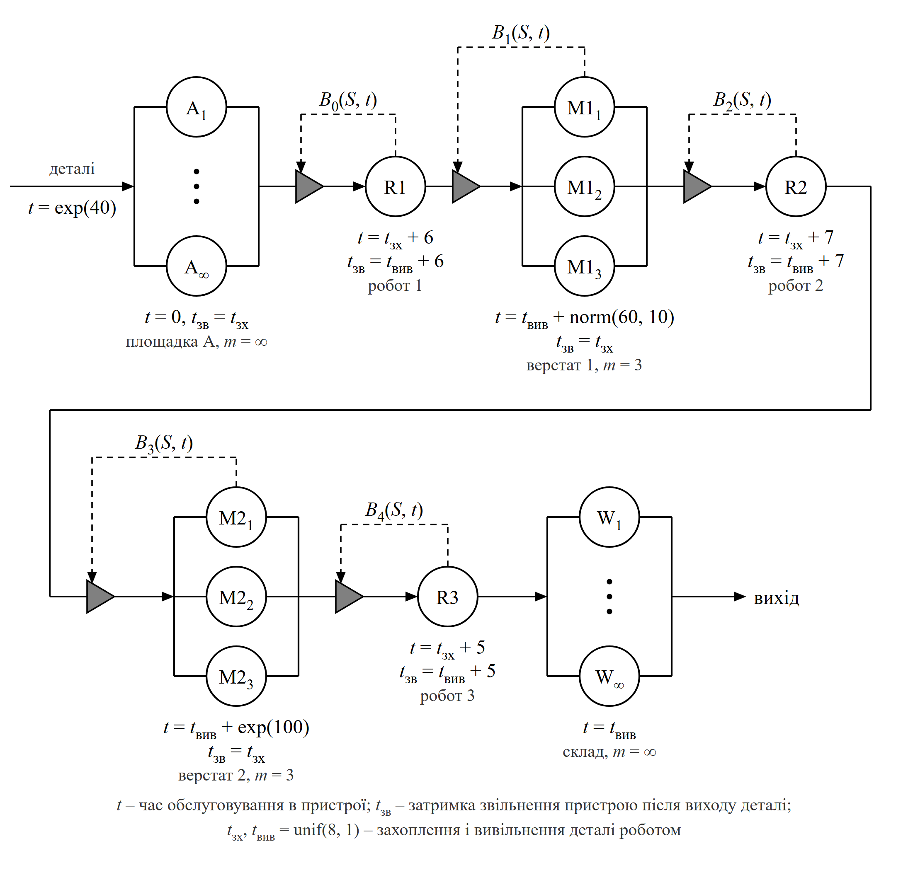
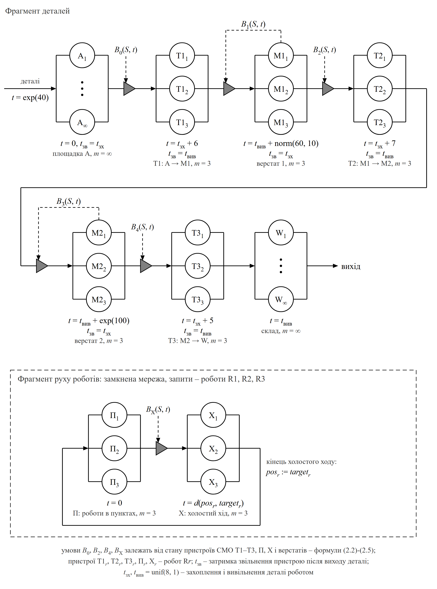

# 2 ФОРМАЛІЗОВАНА МОДЕЛЬ СИСТЕМИ

Формалізацію виконано засобами мережі масового обслуговування (МО). Мережа МО складається із систем масового обслуговування (СМО), з'єднаних дугами, що представляють маршрут слідування запитів, і зовнішнього потоку надходження запитів [@mk, с. 50]. Графічні позначення елементів і їх числові параметри прийнято за таблицею 3.1 методичних рекомендацій [@mk, с. 52-54], правила функціонування мережі і блокування маршрутів – за навчальним посібником [@tb, с. 62-67].

## 2.1 Відповідність елементів системи елементам мережі МО

Запитом мережі є деталь. Мережа розімкнена: деталі надходять ззовні на площадку A і залишають мережу після вивільнення на складі. Під час обслуговування деталь не знищується, не з'єднується з іншими деталями і не розпадається, тому процес можна описати мережею МО [@tb, с. 65].

Кожне місце, де може перебувати деталь, представлено пристроєм обслуговування: місце на площадці A, місце на верстаті, захват робота, місце на складі. Деталь переходить з одного пристрою в інший дугою мережі. Умови «немає вільного робота» і «на верстаті немає місця» задано блокуванням маршрутів: якщо маршрут закритий, запит залишається в пристрої, з якого намагається вийти, і пристрій переходить у стан «блокований» [@mk, с. 54]. Блокування стоїть на дузі між СМО. Між чергою і пристроями СМО його розмістити не можна, бо черга є частиною СМО і з'єднується з пристроями відрізком, а не дугою [@mk, с. 53]. Тому деталь, що чекає на робота, не стоїть у черзі, а займає місце площадки чи верстата як заблокований пристрій.

Стан кожного пристрою набуває трьох значень: 0 – вільний, 1 – зайнятий, 2 – блокований [@mk, с. 68]. Окрім часу обслуговування $t$, для пристрою задано затримку звільнення $t_{\text{зв}}$ – час, протягом якого пристрій залишається зайнятим після виходу запиту. Вона потрібна з двох причин. По-перше, захоплення і вивільнення деталі робот виконує разом із місцем: під час захоплення деталь ще лежить на місці-джерелі, а під час вивільнення вже займає місце-приймач. По-друге, після вивільнення робот звільняється не одразу: у варіанті 1 він повертається порожнім до точки завантаження свого шляху. Тривалості захоплення $t_{\text{зх}}$ і вивільнення $t_{\text{вив}}$ генеруються в момент переходу деталі між місцем і роботом і зараховуються обом пристроям: пристрою, у який переходить деталь, – як частина часу обслуговування, а пристрою, з якого вона вийшла, – як затримка звільнення.

Затримка звільнення не додає до мережі МО нових елементів чи подій. Це другий часовий параметр пристрою, а її кінець – така сама подія «завершення обслуговування», лише в пристрої вже немає запиту. Деталь у кожен момент перебуває лише в одному пристрої, а затримка тільки продовжує зайнятість пристрою, з якого деталь вийшла. Без неї захоплення і вивільнення довелося б віднести лише до пристрою робота: місце верстата звільнялося б на початку захоплення, а займалося б лише після вивільнення. Тоді місце M2 на кожну деталь було б зайняте на 16 с менше, ніж насправді, – 100 с замість 116 с, і гранична продуктивність трьох місць M2 без простоїв зросла б з $3 \cdot 3600 / 116 \approx 93$ до $3 \cdot 3600 / 100 = 108$ дет./год. Модель недооцінювала б завантаження саме того верстата, який обмежує пропускну здатність системи (підрозділ 5.1), тому захоплення і вивільнення враховано затримкою звільнення. Відповідність елементів системи елементам мережі МО наведено в таблиці 2.1.

Таблиця 2.1 – Відповідність елементів системи елементам мережі МО

| Елемент системи | Варіант 1 | Варіант 2 |
|---|---|---|
| деталь | запит | те саме |
| надходження деталей | зовнішнє надходження, $t = \exp(40)$ | те саме |
| площадка A | СМО A з необмеженою кількістю пристроїв (місць) | те саме |
| роботи | три одноканальні СМО R1, R2, R3, кожна на своєму шляху | три триканальні СМО T1, T2, T3, по одній на кожному шляху; пристрої $\mathrm{T1}_r$, $\mathrm{T2}_r$, $\mathrm{T3}_r$ – робот R$r$ |
| рух робота без деталі | затримка звільнення пристрою робота (повернення до точки завантаження) | фрагмент руху роботів: СМО П і Х з пристроями $\text{П}_r$, $\text{Х}_r$, запити – роботи |
| верстат M1, M2 | СМО з трьох пристроїв (місць) без черги | те саме |
| склад | СМО W з необмеженою кількістю пристроїв, далі вихід з мережі | те саме |
| «немає вільного робота», «на верстаті немає місця», вибір найближчого робота | блокування маршрутів $B_0$-$B_4$ | блокування маршрутів $B_0$-$B_4$ і $B_{\text{Х}}$ |

Маршрути переміщення деталей наведено в таблиці 2.2. Тут і далі $src_S$ і $dst_S$ – точки завантаження і вивантаження шляху $S$, $d_S$ – час переміщення з деталлю.

Таблиця 2.2 – Маршрути переміщення деталей

| Шлях $S$ | Звідки, $src_S$ | Куди, $dst_S$ | $d_S$, с | Робот у варіанті 1 | Де деталь чекає на робота |
|:-:|:-:|:-:|:-:|:-:|---|
| 1 | A | M1 | 6 | R1: A ⇄ M1 | на місці площадки A |
| 2 | M1 | M2 | 7 | R2: M1 ⇄ M2 | на місці верстата M1 |
| 3 | M2 | W | 5 | R3: M2 ⇄ W | на місці верстата M2 |

## 2.2 Мережа МО для варіанта 1

Мережу МО, що представляє формалізовану модель ГВС для варіанта 1, наведено на рисунку 2.1. Кожен робот закріплений за одним шляхом, тому йому відповідає окрема одноканальна СМО. Верстат, що одночасно обробляє до трьох деталей, є СМО з трьох ідентичних пристроїв (місць) без черги. Площадка A і склад W – СМО з необмеженою кількістю пристроїв, бо кількість місць на них не обмежена.

Деталь проходить мережу послідовно: A → R1 → M1 → R2 → M2 → R3 → W → вихід. На площадці A час обслуговування дорівнює нулю: деталь одразу намагається перейти до робота R1 і, якщо він зайнятий, чекає на своєму місці. Обслуговування деталі роботом R1 триває $t_{\text{зх}} + 6$: робот захоплює деталь і везе її до M1. Місце площадки звільняється в кінці захоплення, тому його затримка звільнення дорівнює $t_{\text{зх}}$. Коли деталь переходить на місце верстата M1, починається її вивільнення, тож час обслуговування на M1 дорівнює $t_{\text{вив}} + t_{\text{обр}1}$. Робот R1 після переходу деталі ще вивільняє її, а потім за 6 с повертається порожнім до A. Тому пристрій R1 звільняється із затримкою $t_{\text{зв}} = t_{\text{вив}} + 6$, і лише після цього може взяти наступну деталь. Так само працюють R2 і R3. Оброблена деталь переходить з місця верстата до робота, а місце звільняється в кінці захоплення, тобто із затримкою $t_{\text{зх}}$. На складі деталь вивільняється ($t = t_{\text{вив}}$) і залишає мережу.

Трикутники на рисунку 2.1 позначають блокування маршрутів, пунктирні лінії – керуючі зв'язки від елемента, стан якого визначає умову блокування. Зміст блокувань наведено в таблиці 2.3.

Таблиця 2.3 – Блокування маршрутів у варіанті 1

| Умова | Маршрут | Маршрут закритий, якщо | Де чекає деталь |
|:-:|:-:|---|---|
| $B_0$ | A → R1 | робот R1 зайнятий | на місці площадки A |
| $B_1$ | R1 → M1 | усі 3 місця M1 зайняті | у пристрої R1: робот тримає деталь біля M1 |
| $B_2$ | M1 → R2 | робот R2 зайнятий | на місці верстата M1 |
| $B_3$ | R2 → M2 | усі 3 місця M2 зайняті | у пристрої R2: робот тримає деталь біля M2 |
| $B_4$ | M2 → R3 | робот R3 зайнятий | на місці верстата M2 |

Блокування задано предикатами, які залежать від стану мережі $S$ у момент $t$ [@mk, с. 54]. Позначимо $K_{E,j}$ стан $j$-го пристрою СМО $E$ у момент $t$: 0 – вільний, 1 – зайнятий, 2 – блокований. Тоді

$$
\begin{gathered}
B_0(S, t) = (K_{\mathrm{R1}} \ne 0), \qquad B_2(S, t) = (K_{\mathrm{R2}} \ne 0),\\
B_4(S, t) = (K_{\mathrm{R3}} \ne 0),\\
B_1(S, t) = (K_{\mathrm{M1},1} \ne 0) \land (K_{\mathrm{M1},2} \ne 0) \land (K_{\mathrm{M1},3} \ne 0),\\
B_3(S, t) = (K_{\mathrm{M2},1} \ne 0) \land (K_{\mathrm{M2},2} \ne 0) \land (K_{\mathrm{M2},3} \ne 0),
\end{gathered}
\tag{2.1}
$$

де логічний вираз дорівнює 1, якщо він істинний, і 0, якщо хибний; $\land$ – логічна операція «ТА», тож $B_1$ і $B_3$ дорівнюють 1, лише коли всі три пристрої верстата не вільні. Маршрут закритий, якщо $B(S, t) = 1$. Маршрути надходження, R3 → W і W → вихід не блокуються.

Блокування $B_1$ і $B_3$ перевіряються в момент, коли робот закінчив переміщення з деталлю. Якщо вільного місця немає, деталь залишається в пристрої робота, тобто робот тримає її біля верстата [@tb, с. 67], і переходить на верстат, щойно там звільниться місце. Блокування $B_0$, $B_2$, $B_4$ тримають деталь на її місці, доки робот не звільниться, тобто не вивільнить попередню деталь і не повернеться до точки завантаження. Якщо на відкриття маршруту чекають кілька пристроїв, першим виходить запит, що був заблокований раніше.

## 2.3 Мережа МО для варіанта 2

У варіанті 2 будь-який вільний робот може перевезти деталь будь-яким шляхом. Тому на кожному шляху $S$ роботам відповідає триканальна СМО T$S$ з пристроями $\mathrm{T}S_1$, $\mathrm{T}S_2$, $\mathrm{T}S_3$, де пристрій $\mathrm{T}S_r$ – це робот R$r$ (рисунок 2.2). Кожен пристрій має власну назву, тому в умовах блокування видно, про який саме пристрій ідеться. Деталь проходить мережу тим самим маршрутом, що й у варіанті 1: A → T1 → M1 → T2 → M2 → T3 → W → вихід. Отже, обов'язковий маршрут деталі A – M1 – M2 – W зберігається, а від способу закріплення роботів залежить лише те, який пристрій СМО перевезення обслуговує деталь.

Пристрої $\mathrm{T1}_r$, $\mathrm{T2}_r$, $\mathrm{T3}_r$ відповідають одному роботу R$r$, тому зайнятим може бути лише один з них. Крім того, робот може захопити деталь лише в тій точці, де він стоїть, а після вивільнення залишається в точці вивантаження. Тому маршрути роботів відстежує окремий фрагмент мережі – фрагмент руху роботів (нижня частина рисунка 2.2). Це замкнена мережа з двох СМО, у якій циркулюють $N_R = 3$ запити – роботи:

- П – роботи в пунктах: запит робота R$r$ перебуває в пристрої $\text{П}_r$, поки робот не їде порожнім, тобто стоїть у точці $pos_r$ або працює з деталлю в пристрої СМО T1-T3; $t = 0$;
- Х – холостий хід: обслуговування запиту робота R$r$ у пристрої $\text{Х}_r$ триває $d(pos_r, target_r)$ – час переїзду до точки завантаження $target_r = src_S$ обраного шляху $S$; після цього $pos_r := target_r$, і запит повертається в $\text{П}_r$.

Після вивільнення деталі на шляху $S$ робот залишається в точці вивантаження: $pos_r := dst_S$. Фрагменти взаємодіють лише через блокування маршрутів, окремих елементів керування в мережі немає. Умови $B_1$ і $B_3$ мають той самий зміст, що й у варіанті 1. Умови $B_0$, $B_2$, $B_4$ на маршрутах деталей до роботів і $B_{\text{Х}}$ на маршруті П → Х залежать від стану пристроїв СМО T1–T3, П, Х і верстатів, і саме через них задано правило вибору найближчого вільного робота. Зміст блокувань наведено в таблиці 2.4.

Таблиця 2.4 – Блокування маршрутів у варіанті 2

| Умова | Маршрут | Маршрут закритий, якщо | Де чекає запит |
|:-:|:-:|---|---|
| $B_0$ | A → T1 | у точці A немає вільного робота або до M1 уже везуть деталі (чи їдуть по них) більше роботів, ніж там вільних місць | деталь на місці площадки A |
| $B_1$ | T1 → M1 | усі 3 місця M1 зайняті | деталь у пристрої T1: робот тримає її біля M1 |
| $B_2$ | M1 → T2 | у точці M1 немає вільного робота або до M2 уже везуть деталі (чи їдуть по них) більше роботів, ніж там вільних місць | деталь на місці верстата M1 |
| $B_3$ | T2 → M2 | усі 3 місця M2 зайняті | деталь у пристрої T2: робот тримає її біля M2 |
| $B_4$ | M2 → T3 | у точці M2 немає вільного робота | деталь на місці верстата M2 |
| $B_{\text{Х}}$ | П → Х | робот R$r$ не входить до пари з найменшим холостим ходом за правилом (2.5) | запит робота в пристрої $\text{П}_r$ |

Для запису предикатів через стан елементів мережі введемо величини (усі – у момент $t$):

$$
\begin{aligned}
F_r &= (K_{\mathrm{T1},r} = 0) \land (K_{\mathrm{T2},r} = 0) \land (K_{\mathrm{T3},r} = 0) \land (K_{\text{Х},r} = 0),\\
V_P &= \sum_{r} \mathbf{1}\{F_r \land pos_r = P\}, \qquad f_S = \sum_{j=1}^{3} \mathbf{1}\{K_{\mathrm{M}S,j} = 0\},\\
h_P &= \sum_{r} \mathbf{1}\{K_{\text{Х},r} \ne 0 \land target_r = P\}, \qquad u_S = \sum_{r} z_{\mathrm{T}S,r} + h_{src_S},\\
D_S &= (u_S > f_S),\ S = 1, 2, \qquad D_3 = 0,
\end{aligned}
\tag{2.2}
$$

де $F_r = 1$, якщо робот R$r$ вільний: не обслуговує і не тримає деталь та не їде порожнім; $V_P$ – кількість вільних роботів у точці $P$; $f_S$ – кількість вільних місць верстата M$S$; $h_P$ – кількість роботів, що їдуть порожнім до точки $P$, $target_r$ – точка призначення холостого ходу робота R$r$; $z_{\mathrm{T}S,r} = 1$, якщо в пристрої $\mathrm{T}S_r$ є деталь (робот R$r$ захоплює її, везе або тримає біля заповненого верстата), і 0, якщо пристрій вільний або деталь уже вивільняється (затримка звільнення); $u_S$ – кількість роботів, які везуть деталь до верстата M$S$ або їдуть по таку деталь; $D_S = 1$, якщо таких роботів більше, ніж вільних місць на верстаті. Тоді

$$
\begin{aligned}
B_0(S, t) &= (V_{\mathrm{A}} = 0) \lor D_1,\\
B_2(S, t) &= (V_{\mathrm{M1}} = 0) \lor D_2,\\
B_4(S, t) &= (V_{\mathrm{M2}} = 0),
\end{aligned}
\tag{2.3}
$$

де $\lor$ – логічна операція «АБО», а $B_1$ і $B_3$ – як у формулі (2.1). Якщо в точці $src_S$ стоять кілька вільних роботів, деталь переходить до будь-якого з них, бо роботи в одній точці рівноцінні.

Умова $D_S = 0$ визначає, коли вільний робот може взяти деталь до верстата: не можна брати деталь для верстата, до якого вже везуть деталі (чи їдуть по них) на одного робота більше, ніж там вільних місць. Кількість роботів при цьому не змінюється, їх три за умовою. Правило лише не дає трьом роботам одночасно стати з деталями біля заповненого верстата. Робот, який привіз деталь до заповненого верстата, тримає її і не може виконувати інших перевезень. Якщо всі три роботи візьмуть деталі для заповненого M2, оброблені деталі на M2 нікому вивезти на склад, місця на M2 не звільняються, і система зупиняється (взаємне блокування). У пробних прогонах без цього правила таке блокування в усіх п'яти прогонах наставало на 320-1172-й секунді, після чого жодна деталь на склад не надходила. Оскільки умова перевіряється перед тим, як деталь перейде до робота, завжди $u_S \le f_S + 1$, тобто біля кожного верстата з деталлю чекає не більше одного робота. Тоді заблокованими можуть бути щонайбільше два роботи, біля M1 і M2, а третій завжди може вивезти деталь з M2 на склад, бо цей маршрут не блокується. Місце на M2 звільняється, і рух відновлюється. У варіанті 1 до кожного верстата їздить лише свій робот, тому така умова виконується автоматично.

Умову $B_{\text{Х}}$ на маршруті П → Х задає правило вибору найближчого вільного робота. Множина допустимих пар «робот – шлях»:

$$
\begin{aligned}
P(t) &= \{(r, S):\ F_r \land pos_r \ne src_S \land q_S > 0 \land \lnot D_S\},\\
q_S &= w_S - h_{src_S} - V_{src_S},
\end{aligned}
\tag{2.4}
$$

де $\lnot$ – логічне заперечення; $w_S$ – кількість деталей, що чекають на робота в точці $src_S$, тобто заблокованих пристроїв СМО A, M1 або M2; $q_S$ – кількість таких деталей, по які ще не їде і біля яких не стоїть вільний робот. З множини $P(t)$ обирається пара з найменшим холостим ходом, і маршрут П → Х відкривається лише для пристрою $\text{П}_{r^*}$ робота з цієї пари:

$$
\begin{aligned}
(r^*, S^*) &= \arg\min_{(r, S) \in P(t)} d(pos_r, src_S),\\
B_{\text{Х}}(S, t) &= \bigl(P(t) = \varnothing\bigr) \lor (r \ne r^*) \ \text{ для пристрою } \text{П}_r,
\end{aligned}
\tag{2.5}
$$

де $d(pos_r, src_S)$ – час холостого ходу робота R$r$ із точки, де він стоїть, до точки завантаження $src_S$. Якщо однаково близьких пар кілька, обирається випадкова з них. Коли маршрут відкривається, запит робота R$r^*$ переходить з $\text{П}_{r^*}$ у $\text{Х}_{r^*}$, і $target_{r^*} := src_{S^*}$. Від цього $h_{src_{S^*}}$ збільшується на 1, тож умова перевіряється знову, доки множина $P(t)$ не стане порожньою. Умову $B_{\text{Х}}$ перевіряють після переходів деталей у момент $t$, бо вона залежить від того, скільки деталей чекає на робота. Робот, який уже стоїть у точці $src_S$, холостого ходу не виконує: деталь переходить до нього маршрутом до СМО T$S$, щойно блокування $B_0$, $B_2$ чи $B_4$ знімається. Отже, кожну деталь перевозить найближчий з вільних роботів, як вимагає умова завдання.

## 2.4 Часові параметри пристроїв

Час обслуговування і затримку звільнення пристроїв усіх СМО наведено в таблиці 2.5.

Таблиця 2.5 – Час обслуговування $t$ і затримка звільнення $t_{\text{зв}}$ пристроїв мережі

| СМО | $t$ | $t_{\text{зв}}$ | Що відбувається з деталлю і роботом |
|:-:|:-:|:-:|---|
| A | 0 | $t_{\text{зх}}$ | деталь займає місце площадки від надходження до кінця захоплення |
| R$S$ (варіант 1) | $t_{\text{зх}} + d_S$ | $t_{\text{вив}} + d_S$ | захоплення і переміщення з деталлю; після переходу деталі – вивільнення і повернення робота до $src_S$ |
| T$S$ (варіант 2) | $t_{\text{зх}} + d_S$ | $t_{\text{вив}}$ | захоплення і переміщення з деталлю; після переходу деталі – вивільнення, робот залишається в $dst_S$ |
| M1 | $t_{\text{вив}} + t_{\text{обр}1}$ | $t_{\text{зх}}$ | вивільнення і обробка; після переходу деталі до робота – захоплення |
| M2 | $t_{\text{вив}} + t_{\text{обр}2}$ | $t_{\text{зх}}$ | те саме |
| W | $t_{\text{вив}}$ | 0 | вивільнення на складі, після нього деталь залишає мережу |
| П | 0 | 0 | робот стоїть у точці $pos_r$ або працює з деталлю |
| Х | $d(pos_r, target_r)$ | 0 | холостий хід робота до точки завантаження |

Час обслуговування в СМО робота не включає блокування: якщо на верстаті немає місця, пристрій робота блокований, і деталь чекає в ньому. Отже, у варіанті 1 робот зайнятий однією деталлю протягом

$$
\begin{gathered}
t_{\mathrm{R}S} + \tau_{\text{бл}} = t_{\text{зх}} + d_S + \tau_{\text{бл}} + t_{\text{вив}} + d_S,\\
\bar t_{\mathrm{R1}} = 28 \text{ с}, \quad \bar t_{\mathrm{R2}} = 30 \text{ с}, \quad \bar t_{\mathrm{R3}} = 26 \text{ с},
\end{gathered}
\tag{2.6}
$$

де $\tau_{\text{бл}} \ge 0$ – час блокування, $\bar t$ – середнє значення без блокування. Холостий хід у варіанті 1 виконується після вивільнення, тож деталь чекає на робота лише тоді, коли надійшла раніше, ніж він повернувся. У варіанті 2 до часу роботи з деталлю додається холостий хід із точки $pos_r$, де стоїть робот, до точки завантаження. Час переміщення між пунктами задано матрицею

$$
D = \begin{array}{c|cccc}
 & \mathrm{A} & \mathrm{M1} & \mathrm{M2} & \mathrm{W} \\ \hline
\mathrm{A} & 0 & 6 & 13 & 18 \\
\mathrm{M1} & 6 & 0 & 7 & 12 \\
\mathrm{M2} & 13 & 7 & 0 & 5 \\
\mathrm{W} & 18 & 12 & 5 & 0
\end{array},
\tag{2.7}
$$

з якої для кожного шляху отримуємо межі часу, протягом якого робот зайнятий деталлю без блокування:

$$
\begin{cases}
d(pos_r, \mathrm{A}) + t_{\text{зх}} + 6 + t_{\text{вив}}, & 20 < t < 42 \text{ с},\\
d(pos_r, \mathrm{M1}) + t_{\text{зх}} + 7 + t_{\text{вив}}, & 21 < t < 37 \text{ с},\\
d(pos_r, \mathrm{M2}) + t_{\text{зх}} + 5 + t_{\text{вив}}, & 19 < t < 36 \text{ с}.
\end{cases}
\tag{2.8}
$$

Найменші значення досягаються, коли робот уже стоїть у точці завантаження: наприклад, робот, що вивільнив деталь на M2, одразу забирає з M2 оброблену деталь на склад. Середній холостий хід у варіанті 2 заздалегідь невідомий, бо залежить від того, де стоять вільні роботи в момент вибору, тому його оцінюють за результатами імітації.

## 2.5 Числові параметри та генератори випадкових величин

Числові значення параметрів і вхідних змінних мережі наведено в таблицях 1.1 і 1.2 та на рисунках 2.1 і 2.2: інтервал надходження $\exp(40)$, час обробки на M1 $\mathrm{norm}(60, 10)$, на M2 $\exp(100)$, час захоплення і вивільнення $\mathrm{unif}(8, 1)$, по три місця на верстатах, переміщення 6, 7 і 5 с, необмежена кількість місць площадки A. Усі випадкові величини незалежні, $t_{\text{зх}}$ і $t_{\text{вив}}$ генеруються окремо для кожного переходу деталі між місцем і роботом. Значення випадкових величин отримуються з рівномірно розподіленої на $(0;\ 1)$ величини $\zeta$ за формулами [@tb, с. 157-161]:

$$
\begin{gathered}
\exp(d):\ x = -d\,\ln\zeta; \qquad \mathrm{unif}(d, s):\ x = d - s + 2s\zeta;\\
\mathrm{norm}(d, s):\ x = d + s\,z,
\end{gathered}
\tag{2.9}
$$

де $z$ – стандартна нормальна величина, отримана полярним методом Марсальї – Брея:

$$
\begin{gathered}
v_1 = 2\zeta_1 - 1,\quad v_2 = 2\zeta_2 - 1,\quad w = v_1^2 + v_2^2,\\
z_{1,2} = v_{1,2}\sqrt{\frac{-2\,\ln w}{w}}.
\end{gathered}
\tag{2.10}
$$

Пара $\zeta_1, \zeta_2$ генерується знову, доки не виконається умова $0 < w \le 1$, а один розрахунок дає два значення $z$. Якщо $t_{\text{обр}1} \le 0$, значення генерується повторно.

## 2.6 Стан мережі, правила функціонування та початковий стан

Стан мережі $S(t)$ у момент $t$ описують змінні, визначені для елементів мережі МО в методичних рекомендаціях [@mk, с. 67-70]:

- $t_0$ – момент наступного надходження деталі;
- $K_{E,j}(t)$, $t_{E,j}$ і $z_{E,j}(t)$ – стан $j$-го пристрою СМО $E$, момент завершення його обслуговування або затримки звільнення ($t_{E,j} = \infty$, якщо подія не очікується) і наявність у пристрої запиту: $z_{E,j} = 1$ під час обслуговування і блокування, $z_{E,j} = 0$ під час затримки звільнення і коли пристрій вільний;
- для кожного маршруту – заблоковані пристрої, що чекають на його відкриття, у порядку блокування;
- у варіанті 2 – $pos_r(t)$ і $target_r$: точка, де стоїть робот R$r$, і точка призначення його холостого ходу.

Мережа функціонує за такими правилами:

1) деталь, що надійшла, займає вільне місце площадки A і одразу намагається перейти до робота;
2) після завершення обслуговування запит переходить у наступну СМО, якщо маршрут відкритий: займає вільний пристрій (на верстаті – вільне місце з найменшим номером, у СМО T$S$ – пристрій вільного робота, що стоїть у точці $src_S$), а пристрій, з якого він вийшов, звільняється одразу або після затримки $t_{\text{зв}}$;
3) якщо маршрут закритий, пристрій переходить у стан 2, запит залишається в ньому; блокування знімається, щойно $B(S, t) = 0$, і першим виходить запит, заблокований раніше, а на маршруті П → Х – запит робота R$r^*$, для пристрою якого $B_{\text{Х}} = 0$;
4) у варіанті 2 умова $B_{\text{Х}}$ перевіряється після переходів деталей у момент $t$, бо вона залежить від того, скільки деталей чекає на робота; запит робота, що надійшов у пристрій П, до цієї перевірки залишається в стані 2;
5) події, які настають в один момент часу, обробляються у випадковому порядку, причому завершення обслуговування обробляються раніше за надходження нової деталі [@mk, с. 66].

У початковий момент $t = 0$ усі пристрої вільні, а роботи стоять у точках завантаження шляхів варіанта 1: R1 – в A, R2 – в M1, R3 – в M2. Для варіанта 2 прийнято той самий стан: $pos_1 = \mathrm{A}$, $pos_2 = \mathrm{M1}$, $pos_3 = \mathrm{M2}$, запити роботів – у пристроях $\text{П}_1$, $\text{П}_2$, $\text{П}_3$ у стані 2. Перша деталь надходить у момент $\tau_{A,1}$.

## 2.7 Обчислення вихідних характеристик та вимоги до точності

Статистика збирається на інтервалі $[T_{\text{п}};\ T_{\text{mod}}]$ тривалістю $T = T_{\text{mod}} - T_{\text{п}}$, де $T_{\text{mod}}$ – час моделювання, $T_{\text{п}}$ – тривалість перехідного періоду. Стан мережі змінюється лише в моменти подій $t_k$ і між сусідніми подіями сталий. Тому середні за часом величини обчислюються як суми за інтервалами $\Delta t_k = t_{k+1} - t_k$ між послідовними подіями [@mk, с. 59]. Формули обчислення вихідних характеристик наведено в таблиці 2.6, де $L_A(t) = \sum_j \mathbf{1}\{K_{\mathrm{A},j}(t) \ne 0\}$ – кількість зайнятих місць площадки A.

Таблиця 2.6 – Формули обчислення вихідних характеристик

| Характеристика | Формула обчислення |
|---|---|
| Пропускна здатність, дет./год | $\Lambda = 3600\, N_W / T$, де $N_W$ – кількість деталей, що залишили мережу за час $T$ |
| Час проходження $i$-ї деталі, с | $\tau_i = t_i^{W} - t_i^{A}$ – від надходження на площадку A до кінця вивільнення на складі |
| Середній час проходження і його середнє квадратичне відхилення, с | $\bar\tau = \dfrac{1}{N_W}\displaystyle\sum_{i} \tau_i, \qquad s_\tau = \sqrt{\dfrac{1}{N_W - 1}\displaystyle\sum_{i} (\tau_i - \bar\tau)^2}$ |
| Розподіл часу проходження | гістограма відносних частот $h_k = N_k / N$, де $N_k$ – кількість значень $\tau_i$ у $k$-му інтервалі; відповідність закону розподілу перевіряється за критерієм $\chi^2$ |
| Коефіцієнт використання робота R$r$ | $\rho_r = \dfrac{1}{T}\displaystyle\sum_{k} \bigl(1 - F_r(t_k)\bigr)\,\Delta t_k$ – частка часу, коли хоча б один пристрій робота не вільний: робот працює з деталлю, тримає її, вивільняє, повертається або їде порожнім |
| Коефіцієнт використання верстата M$i$ | $\rho_{\mathrm{M}i} = \dfrac{1}{3T}\displaystyle\sum_{k} \sum_{j=1}^{3} \mathbf{1}\{K_{\mathrm{M}i,j}(t_k) \ne 0\}\,\Delta t_k$ |
| Частка блокування верстата M$i$ | $\rho^{\text{бл}}_{\mathrm{M}i} = \dfrac{1}{3T}\displaystyle\sum_{k} \sum_{j=1}^{3} \mathbf{1}\{K_{\mathrm{M}i,j}(t_k) = 2\}\,\Delta t_k$ |
| Максимальна місткість місця зберігання на ділянці прибуття, шт. | $L_{max} = \max\limits_{t_k \in [T_{\text{п}};\ T_{\text{mod}}]} L_A(t_k)$ |
| Середня кількість деталей на площадці A, од. | $\bar L_A = \dfrac{1}{T}\displaystyle\sum_{k} L_A(t_k)\,\Delta t_k$ |

У варіанті 1 $F_r = (K_{\mathrm{R}r} = 0)$. Кожна вихідна характеристика оцінюється як середнє $\bar x$ за серією з $p$ незалежних прогонів моделі з різними початковими значеннями генераторів. Кількість прогонів визначається за нерівністю Чебишова [@mk, с. 81]:

$$
p = \frac{\sigma^2}{\varepsilon^2 (1 - \beta)}, \qquad \beta = 0{,}95 \;\Rightarrow\; p = 20\left(\frac{\sigma}{\varepsilon}\right)^2,
\tag{2.11}
$$

де $\sigma$ – середнє квадратичне відхилення характеристики за пілотною серією з 20 прогонів; $\varepsilon$ – допустима похибка; $\beta$ – довірча ймовірність. Для пропускної здатності, часу проходження і коефіцієнтів використання прийнято $\varepsilon = 0{,}02\,\bar x$, тобто 2% від середнього значення. Для максимальної місткості площадки, яка є цілим числом, точність задано абсолютною – 1-2 деталі. Тривалість перехідного періоду і кількість прогонів визначено в підрозділі 4.2.

## 2.8 Висновки до розділу

У розділі побудовано формалізовані моделі ГВС для обох способів закріплення роботів у термінах мережі масового обслуговування. Місця площадки, верстатів і складу та роботи представлено пристроями СМО зі станами «вільний», «зайнятий», «блокований». Захоплення і вивільнення деталі, повернення робота у варіанті 1 враховано затримкою звільнення пристроїв, яка не додає до мережі нових елементів і подій. У варіанті 1 кожен робот є окремою одноканальною СМО. У варіанті 2 на кожному шляху є триканальна СМО роботів з окремо названими пристроями, а положення роботів і їх холості ходи відстежує окремий фрагмент мережі. Умови «немає вільного робота» і «на верстаті немає місця» описано предикатами блокування маршрутів через стан елементів мережі. Для варіанта 2 правило вибору найближчого вільного робота й умову, що виключає взаємне блокування роботів, також записано як предикати блокування маршрутів, тому фрагменти мережі взаємодіють лише через блокування. Визначено змінні стану, правила функціонування, початковий стан, формули обчислення вихідних характеристик і вимоги до точності їх оцінювання.
