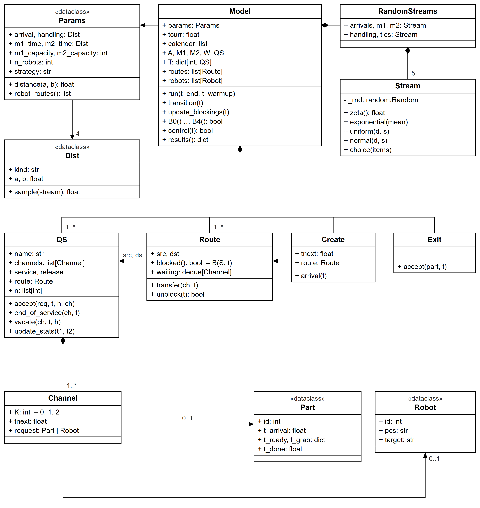

# 3 АЛГОРИТМІЗАЦІЯ ТА ПРОГРАМНА РЕАЛІЗАЦІЯ ІМІТАЦІЙНОЇ МОДЕЛІ СИСТЕМИ

У розділі описано алгоритм імітації, побудований за формалізованою моделлю розділу 2, і його програмну реалізацію: просування часу, просування стану мережі МО в часі, перевірку умов блокування, керування роботами, генерування випадкових величин і збір статистики. Алгоритм імітації власний: спеціалізовані бібліотеки імітації не використовуються. Повний код наведено в додатках Б і В, а також у репозиторії проєкту.

## 3.1 Обґрунтування вибору мови програмування

Для програмної реалізації обрано мову Python [@python]. Вона дає змогу компактно описати елементи мережі МО класами, а модуль `dataclasses` – задати параметри і структури даних без службового коду. Python також має розвинені бібліотеки для статистичної обробки результатів. Бібліотеки NumPy [@numpy] і SciPy [@scipy] використано лише на етапі експериментального дослідження: для обчислення квантилів розподілів Стьюдента, Фішера і $\chi^2$, оцінювання параметрів законів розподілу і дисперсійного аналізу. Графіки побудовано бібліотекою Matplotlib [@mpl]. Сам алгоритм імітації використовує лише стандартну бібліотеку Python.

Недоліком Python є менша швидкодія порівняно з компільованими мовами C++ і Java. Для цієї моделі вона достатня: один прогін тривалістю 300 000 с модельного часу виконується приблизно за 1 с у варіанті 1 і за 2 с у варіанті 2. Серії незалежних прогонів виконуються паралельно в окремих процесах за допомогою модуля `concurrent.futures`. Коректність окремих частин алгоритму перевіряється автоматичними тестами (бібліотека pytest).

## 3.2 Структура програми

Програма є пакетом `fms` із модулями, наведеними в таблиці 3.1.

Таблиця 3.1 – Модулі програми

| Модуль | Призначення |
|---|---|
| `rng.py` | генератори випадкових величин: окремі потоки чисел для кожного джерела випадковості, закони $\exp$, $\mathrm{unif}$, $\mathrm{norm}$ |
| `params.py` | вхідні змінні та параметри моделі, спосіб закріплення роботів |
| `elements.py` | елементи мережі МО: надходження `Create`, СМО `QS` з пристроями `Channel`, дуга з блокуванням `Route`, вихід `Exit`, а також запити мережі: деталь `Part` і робот `Robot` |
| `model.py` | мережа МО обох варіантів, предикати блокування $B_0$-$B_4$, керування роботами, алгоритм імітації, збір і обчислення вихідних характеристик |
| `experiments/` | експериментальне дослідження: верифікація, перехідний період, кількість прогонів, порівняння варіантів, межа стійкості, розподіл часу проходження, пробні запуски пропозицій |
| `cli.py` | командний інтерфейс для запуску прогонів та експериментів |
| `report_plots.py` | побудова рисунків за результатами експериментів |

Варіант закріплення роботів задається параметром `strategy`: `dedicated` – варіант 1, `nearest` – варіант 2. Від нього залежать склад мережі (СМО R1-R3 або СМО T1-T3 і фрагмент руху роботів П, Х) і предикати блокування. Алгоритм імітації для обох варіантів однаковий, бо він працює з елементами мережі МО, а не з конкретними об'єктами системи.

## 3.3 Алгоритм імітації

Алгоритм імітації побудовано за алгоритмами 3.1 і 3.2 методичних рекомендацій [@mk, с. 65-72] з просуванням часу до найближчої події. Як і в мережі МО, подій лише дві: надходження деталі ззовні і завершення обслуговування в пристрої. Затримка звільнення теж завершується подією «завершення обслуговування», лише в пристрої вже немає запиту. Перехід деталі між СМО, блокування і розблокування маршрутів, а у варіанті 2 також вибір робота є змінами стану, які ці події спричиняють. Псевдокод алгоритму імітації має вигляд:

```text
Алгоритм 3.1 Імітаційне моделювання мережі МО ГВС
вхід: вхідні змінні X, параметри P, поточний час t = 0, час моделювання Tmod,
      перехідний період Tп
використовує перетворення стану мережі E(S, t) (алгоритм 3.2)
ініціалізувати стан мережі S: усі пристрої вільні (K = 0, t_E,j = ∞),
      t0 := τA,1, роботи в A, M1, M2
поки t < Tmod
    знайти момент найближчої події tnext := min(t0, min t_E,j)
    якщо Tп ∈ (t; tnext], оновити статистику на [t; Tп] і обнулити статистику
    оновити статистику вихідних змінних Y на інтервалі [t; tnext]
    перемістити поточний час t := tnext
    викликати перетворення стану S := E(S, t)
кінець поки
обчислити статистику вихідних змінних Y за формулами таблиці 2.6
вивести вихідні змінні Y
```

```text
Алгоритм 3.2 Перетворення стану мережі МО E(S, t)
вхід: стан мережі S, поточний момент t
для кожного пристрою (E, j), для якого t_E,j = t, у випадковому порядку
    t_E,j := ∞
    якщо в пристрої немає запиту                 // кінець затримки звільнення
        K_E,j := 0
    інакше якщо B(S, t) = 1 для маршруту з СМО E // маршрут закритий
        K_E,j := 2, запам'ятати пристрій у черзі блокування маршруту
    інакше ПЕРЕХІД(E, j)
якщо t0 = t                                      // надходження деталі
    зайняти вільне місце j площадки A, t0 := t + τA
    якщо B0(S, t) = 1, то K_A,j := 2, інакше ПЕРЕХІД(A, j)
повторювати, доки стан мережі змінюється         // оновлення блокувань
    для кожного маршруту, для якого B(S, t) = 0
        ПЕРЕХІД для заблокованих пристроїв у порядку блокування
    варіант 2: поки P(t) ≠ ∅, обрати (r*, S*) за правилом (2.5),
        запит робота r* переходить з П у Х:
        K_Х,r* := 1, t_Х,r* := t + d(pos_r*, src_S*)
вивести стан мережі S

ПЕРЕХІД(E, j): запит з пристрою (E, j) переходить у наступну СМО E'
    h := t_зх або t_вив, якщо перехід супроводжує дія робота, інакше h := 0
    обрати вільний пристрій j' СМО E': K_E',j' := 1, t_E',j' := t + t_E'(h)
    якщо t_зв,E(h) > 0: K_E,j := 1, t_E,j := t + t_зв,E(h), інакше K_E,j := 0
```

Статистика оновлюється перед просуванням часу, тому кожен інтервал між подіями враховується зі станом, який був на ньому. Події, що настають одночасно, виконуються у випадковому порядку, бо це найбільш правильний підхід за відсутності явного пріоритету [@mk, с. 66]. Завершення обслуговування виконуються раніше за надходження нової деталі. Умови блокування перевіряються після обробки всіх подій моменту, коли відомий стан усіх пристроїв. Програмна реалізація головного циклу (метод `Model.run`, спрощено: прибрано виклики спостерігача, що використовуються для аналізу перехідного періоду):

```python
def run(self, t_end, t_warmup=0.0):
    pending_reset = t_warmup > 0
    self.update_blockings(0.0)
    while True:
        t_next = self._next_event_time()       # найближча подія
        if pending_reset and t_warmup <= min(t_next, t_end):
            self._advance_stats(t_warmup)      # кінець перехідного періоду:
            self.reset_stats()                 # статистика обнуляється
            pending_reset = False
        if t_next > t_end:
            self._advance_stats(t_end)
            break
        self._advance_stats(t_next)            # статистика на [tcurr; t_next]
        self.transition(self.tcurr)            # перетворення стану E(S, t)
    return self
```

Моменти завершення обслуговування пристроїв зберігаються в календарі подій – купі, з якої найближча подія вибирається без перегляду всіх пристроїв. Перетворення стану за алгоритмом 3.2 виконує метод `Model.transition`:

```python
def transition(self, t):
    due = []
    while self.calendar and self.calendar[0][0] == t:
        _, seq, ch = heapq.heappop(self.calendar)
        if ch.seq == seq and ch.tnext == t:
            due.append(ch)
    self.streams.ties.shuffle(due)             # одночасні події – випадково
    for ch in due:
        ch.qs.end_of_service(ch, t)            # завершення обслуговування
    if self.create.tnext == t:
        self.create.arrival(t)                 # надходження – останнім
    self.update_blockings(t)

def update_blockings(self, t):
    changed = True
    while changed:
        changed = False
        for route in self.routes:              # зняття блокувань, B(S, t) = 0
            changed |= route.unblock(t)
        if self.robot_control:                 # варіант 2: правило (2.5)
            changed |= self.robot_control(t)
```

Наприкінці перехідного періоду обнуляються лише накопичені статистики. Стан мережі (деталі на місцях площадки і верстатів, у пристроях роботів) при цьому не змінюється.

## 3.4 Події та зміна стану елементів мережі

Зміни стану елементів мережі під час подій наведено в таблиці 3.2 у вигляді, прийнятому в методичних рекомендаціях [@mk, с. 68-70].

Таблиця 3.2 – Зміна стану елементів мережі МО

| Елемент | Змінні стану | Подія «надходження деталі», $t_0 = t$ | Подія «завершення обслуговування в пристрої $(E, j)$», $t_{E,j} = t$ |
|---|---|---|---|
| надходження ззовні `Create` | $t_0$ | деталь займає вільне місце площадки A; $t_0 := t + \tau_A$ | без змін |
| пристрій $(E, j)$ СМО `QS` | $K_{E,j}$, $t_{E,j}$, запит у пристрої | для місця площадки: $K := 1$, $t := t$ (нульова затримка) | якщо запиту немає (кінець затримки звільнення): $K := 0$, $t := \infty$; якщо маршрут закритий: $K := 2$, $t := \infty$; якщо відкритий – перехід запиту в наступну СМО, $K := 1$, $t := t + t_{\text{зв}}$ або $K := 0$, $t := \infty$ |
| пристрій СМО-приймача | $K_{E',j'}$, $t_{E',j'}$ | без змін | при переході запиту: $K := 1$, $t := t + t_{E'}(h)$ |
| блокування маршруту `Route` | $B(S, t)$, черга заблокованих пристроїв | оновлення $B(S, t)$ | оновлення $B(S, t)$; якщо $B = 0$, заблоковані пристрої в порядку блокування переводять запит у наступну СМО в момент $t$ |
| керування роботами (варіант 2) | $pos_r$, $target_r$ | вибір пар за правилом (2.5), перехід запитів роботів з П у Х | те саме; у кінці холостого ходу $pos_r := target_r$, у кінці вивільнення $pos_r := dst_S$ |
| вихід `Exit` | $N_W$, масив $\tau_i$ | без змін | кінець вивільнення на складі: $N_W := N_W + 1$, $\tau_i := t - t_i^A$ |

Подію «завершення обслуговування» обробляє метод `QS.end_of_service`. Якщо маршрут з СМО закритий, пристрій переходить у стан 2, а запит залишається в ньому. Перехід запиту виконує метод `Route.transfer`. Він генерує тривалість захоплення або вивільнення $h$ і передає її обом СМО: пристрій-джерело звільняється із затримкою $t_{\text{зв}}(h)$, пристрій-приймач починає обслуговування тривалістю $t(h)$ (таблиця 2.5):

```python
def end_of_service(self, ch, t):               # QS: подія в пристрої ch
    ch.tnext = INF
    if ch.request is None:                     # кінець затримки звільнення
        self._vacated(ch, t)                   # K := 0
        return
    if self.route.blocked():                   # B(S, t) = 1
        self.set_state(ch, BLOCKED, t)         # K := 2, запит лишається
        self.route.waiting.append(ch)
    else:
        self.route.transfer(ch, t)

def transfer(self, ch, t):                     # Route: перехід src -> dst
    req = ch.request
    h = self.model.handling_time() if self.handling else 0.0   # t_зх, t_вив
    dst_ch = self.select(req) if self.select else None
    self.src.vacate(ch, t, h)                  # K := 1 на t_зв(h) або K := 0
    self.dst.accept(req, t, h, dst_ch)         # K := 1, t := t + t(h)

def unblock(self, t):                          # Route: зняття блокування
    moved = False
    while self.waiting and not self.blocked():
        self.transfer(self.waiting.popleft(), t)
        moved = True
    return moved
```

## 3.5 Блокування маршрутів і керування роботами

Кожен маршрут мережі (об'єкт `Route`) містить предикат блокування, який перевіряється в момент завершення обслуговування і під час оновлення блокувань. Предикати реалізовано окремими методами моделі, названими так само, як у формулах (2.1) і (2.3). СМО зберігає кількість своїх пристроїв у кожному стані `n[K]`, тому умова «усі пристрої СМО не вільні» перевіряється як `n[FREE] == 0`:

```python
# варіант 1, (2.1)
def B0(self): return self.T[1].n[FREE] == 0    # K_R1 != 0
def B2(self): return self.T[2].n[FREE] == 0    # K_R2 != 0
def B4(self): return self.T[3].n[FREE] == 0    # K_R3 != 0

# обидва варіанти, (2.1): усі місця верстата не вільні
def B1(self): return self.M1.n[FREE] == 0
def B3(self): return self.M2.n[FREE] == 0

# варіант 2, (2.3): у точці src_S немає вільного робота або D_S = 1
def B0_n(self): return not self.free_at("A") or self.D(1)
def B2_n(self): return not self.free_at("M1") or self.D(2)
def B4_n(self): return not self.free_at("M2")

def is_free(self, robot):                      # F_r, (2.2)
    return all(ch.K == FREE for ch in self.robot_channels[robot.id])

def u(self, S):                                # u_S, (2.2)
    return self.T[S].requests + self.heading(SRC[S])

def D(self, S):                                # D_S, (2.2)
    return S != 3 and self.u(S) > self.M[S].n[FREE]
```

Тут `robot_channels[r]` – пристрої робота R$r$ у СМО T1, T2, T3 і Х, `free_at(P)` – вільні роботи в точці $P$, `heading(P)` – кількість роботів, що їдуть порожнім до точки $P$. Маршрут з'єднує СМО так само, як дуга на рисунках 2.1 і 2.2, наприклад:

```python
Route(self, self.T[1], self.M1, self.B1, "B1", handling="вивільнення")
Route(self, self.M1, self.T[2], self.B2, "B2", handling="захоплення",
      select=self._robot_for(2))
```

Параметр `select` задає правило вибору пристрою СМО-приймача. У СМО T$S$ варіанта 2 це пристрій вільного робота, що стоїть у точці $src_S$; якщо таких роботів кілька, обирається випадковий. Керування роботами за формулами (2.4) і (2.5) реалізує метод `Model.control`. Він викликається після обробки всіх подій моменту і відправляє найближчого вільного робота до деталі, по яку ще ніхто не їде (код наведено без рядків запису протоколу і статистики):

```python
def control(self, t):
    moved = False
    while True:
        best = None
        for r in self.robots:
            if not self.is_free(r):            # F_r = 0
                continue
            for S in (1, 2, 3):
                src = SRC[S]
                q = (self.waiting(S) - self.heading(src)
                     - len(self.free_at(src)))              # q_S(t)
                if r.pos == src or q <= 0 or self.D(S):     # (r, S) не в P(t)
                    continue
                key = (self.params.distance(r.pos, src),
                       self.streams.ties.random())
                if best is None or key < best[0]:           # (2.5)
                    best = (key, r, S)
        if best is None:
            return moved
        (d, _), r, S = best
        r.target = SRC[S]                      # B_Х = 0 для обраного робота
        ch = self.P.channels[r.id - 1]
        self.route_PX.waiting.remove(ch)
        self.route_PX.transfer(ch, t)          # запит робота: П -> Х
        moved = True
```

У ключі вибору друге значення – рівномірно розподілена випадкова величина: вона обирає випадкову пару, якщо кілька пар мають однаковий холостий хід.

## 3.6 Генератори випадкових величин

Базову рівномірно розподілену на $(0;\ 1]$ величину $\zeta$ отримує генератор Mersenne Twister з модуля `random` стандартної бібліотеки. Усі інші закони обчислюються власними формулами (2.9) і (2.10). Кожне джерело випадковості моделі має окремий потік чисел із власним зерном: інтервали надходження, обробка на M1, обробка на M2, захоплення і вивільнення, а також вибір серед одночасних подій. Завдяки цьому варіанти 1 і 2 з однаковим зерном отримують однакові послідовності надходжень і часів обробки (спільні випадкові числа). Різниця результатів тоді пояснюється способом закріплення роботів, а не випадковістю. Фрагмент класу потоку `Stream`:

```python
def zeta(self):                          # рівномірна на (0; 1]
    return 1.0 - self._rnd.random()

def exponential(self, mean):             # exp(d): x = -d ln ζ
    return -mean * math.log(self.zeta())

def uniform(self, center, half_width):   # unif(d, s): x = d - s + 2sζ
    return center - half_width + 2.0 * half_width * self._rnd.random()

def standard_normal(self):               # полярний метод Марсальї – Брея
    if self._spare_normal is not None:   # друге значення попередньої пари
        value, self._spare_normal = self._spare_normal, None
        return value
    while True:
        a1 = 2.0 * self._rnd.random() - 1.0
        a2 = 2.0 * self._rnd.random() - 1.0
        s = a1 * a1 + a2 * a2
        if 0.0 < s <= 1.0:
            break
    beta = math.sqrt(-2.0 * math.log(s) / s)
    self._spare_normal = a2 * beta
    return a1 * beta
```

Час обробки на M1 генерується як $\mathrm{norm}(60, 10)$ з повторним генеруванням від'ємних значень. Правильність генераторів перевірено автоматичними тестами: для вибірки з 200 000 значень середнє і середнє квадратичне відхилення збігаються з теоретичними з похибкою до 1 і 2% відповідно.

## 3.7 Збір статистики

Статистика збирається методом `update_stats(t1, t2)`, який викликається перед кожним просуванням часу з моменту $t_1$ у момент $t_2$. Стан мережі на інтервалі $[t_1;\ t_2)$ сталий, тому до накопичених сум додаються добутки на тривалість інтервалу, як у формулах таблиці 2.6:

- СМО верстатів і роботів для кожного пристрою накопичує тривалість станів $K = 0$, 1 і 2; у стані 1 окремо враховується частина, що припадає на захоплення чи вивільнення, бо момент його завершення відомий;
- для площадки A накопичуються сума $\sum_k L_A(t_k)\,\Delta t_k$, розподіл часу за кількістю деталей і найбільша кількість деталей $L_{max}$;
- для коефіцієнта використання робота підсумовується час, коли не вільний хоча б один його пристрій у СМО перевезень і холостого ходу.

За станами пристроїв робота визначається і структура його часу: стан 1 з деталлю – захоплення і переміщення з деталлю, стан 2 – очікування з деталлю біля заповненого верстата, затримка звільнення – вивільнення і повернення (варіант 1), пристрій СМО Х – холостий хід (варіант 2).

Для часу проходження кожна деталь зберігає момент надходження і момент завершення вивільнення на складі, а також моменти готовності до перевезення і початку захоплення на кожному шляху. Наприкінці прогону функція `collect_results` за формулами таблиці 2.6 обчислює всі вихідні характеристики за період $[T_{\text{п}};\ T_{\text{mod}}]$: пропускну здатність, середнє, середнє квадратичне відхилення і квантилі часу проходження, коефіцієнти використання та частки станів верстатів і роботів, а також $L_{max}$, $\bar L_A$ і кількість деталей у системі в кінці прогону. Масив часів проходження використовується для побудови гістограми та перевірки закону розподілу.

## 3.8 Опис класів та UML-діаграма класів

Класи програми та їх призначення наведено в таблиці 3.3, UML-діаграму [@uml] класів – на рисунку 3.1.

Таблиця 3.3 – Класи програми

| Клас | Призначення | Вміст класу |
|---|---|---|
| `Params` | вхідні змінні та параметри моделі | закони розподілу, кількість місць і роботів, розташування пунктів, спосіб закріплення; `distance`, `robot_routes` |
| `Dist` | закон розподілу в позначеннях методичних рекомендацій | вид закону і параметри; `sample(stream)` |
| `Stream`, `RandomStreams` | потоки випадкових чисел, окремий для кожного джерела випадковості | `exponential`, `uniform`, `normal`, `shuffle`, `choice` |
| `Model` | мережа МО і алгоритм імітації | СМО, маршрути, календар подій, роботи; предикати `B0`-`B4`, керування роботами `control`; `run`, `transition`, `update_blockings`, `results` |
| `Create` | надходження деталей ззовні | момент наступного надходження; `arrival` |
| `QS` | СМО з $m$ ідентичних пристроїв без черги ($m$ може бути необмеженим) | пристрої, час обслуговування і затримка звільнення, маршрут з СМО, кількість пристроїв у кожному стані; `accept`, `end_of_service`, `vacate`, `update_stats` |
| `Channel` | пристрій СМО | стан $K$, момент завершення обслуговування, запит у пристрої |
| `Route` | дуга мережі з блокуванням | СМО-джерело і СМО-приймач, предикат $B(S, t)$, черга заблокованих пристроїв; `transfer`, `unblock` |
| `Exit` | вихід з мережі | `accept` фіксує час проходження деталі |
| `Part`, `Robot` | запити мережі: деталь і робот | моменти подій деталі; положення робота і точка призначення холостого ходу |



Модель складається з об'єктів класів `Create`, `QS`, `Route` і `Exit`, тобто з елементів мережі МО. Площадка A, верстати, склад, СМО роботів і СМО фрагмента руху роботів є об'єктами одного класу `QS` і відрізняються лише кількістю пристроїв, часом обслуговування і затримкою звільнення. Тому головний цикл однаково звертається до будь-якого пристрою: знаходить момент найближчої події, виконує подію і оновлює статистику.

## 3.9 Верифікація моделі

Коректність алгоритму імітації доведено верифікацією, яку виконують варіюванням вхідних змінних моделі. Розглянуто 9 сценаріїв, наведених у таблиці 3.4. Кожен сценарій змінює одну вхідну змінну або групу змінних відносно базових значень (таблиця 1.2), і для кожного сформульовано очікувану реакцію моделі. У таблиці $k_d$ – множник часу переміщення роботів (базове значення 1), $m_2$ – кількість місць на верстаті M2.

@include таблиці/verification_scenarios.md

Для кожного сценарію і кожного варіанта виконано 5 прогонів тривалістю $T_{\text{mod}} = 100\,000$ с модельного часу. Статистика збиралася після перехідного періоду $T_{\text{п}} = 10\,000$ с. Змінні, не зазначені в таблиці 3.4, мали базові значення, а для сценарію 9 базовими були час переміщення і кількість місць. Середні за 5 прогонами значення вихідних змінних наведено в таблицях 3.5 і 3.6, де $\bar\rho_{\mathrm{R}}$ – середній коефіцієнт використання роботів, $N_{\text{кін}}$ – кількість деталей у системі в кінці прогону.

@include таблиці/verification_dedicated.md

@include таблиці/verification_nearest.md

Реакція моделі на зміну вхідних змінних в обох варіантах відповідає очікуваній:

1) у базовому прогоні черга на площадці накопичується: $L_{max}$ і $N_{\text{кін}}$ досягають сотень деталей, а пропускна здатність (83,1 і 76,6 дет./год) менша за інтенсивність надходження 90 дет./год, тобто система перевантажена;
2) при $\exp(80)$ пропускна здатність дорівнює інтенсивності надходження 45 дет./год, черга мала, коефіцієнти використання зменшились приблизно вдвічі;
3) при $\exp(30)$ пропускна здатність не змінилась, а черга і час проходження зросли, тобто пропускну здатність обмежує обладнання, а не потік деталей;
4) прискорення обробки на M2 удвічі або 6 місць на M2 (сценарії 4 і 6) роблять систему стійкою: пропускна здатність близька до 90 дет./год, черга не накопичується; отже, вузьким місцем базової системи є верстат M2; незначне перевищення 90 дет./год пояснюється тим, що за час спостереження на склад надходять і деталі, які були в системі на момент $T_{\text{п}}$;
5) при подвоєному часі обробки на M1 коефіцієнт використання M1 наближається до 1 (1,000 і 0,971), а пропускна здатність зменшується до 71,7 і 67,6 дет./год;
6) прискорення захоплення і вивільнення зменшує завантаження роботів і збільшує пропускну здатність, а потроєння часу переміщення діє навпаки; у варіанті 2 роботи при цьому завантажені майже повністю ($\bar\rho_{\mathrm{R}} = 0{,}980$);
7) при детермінованих часах (сценарій 9) пропускна здатність дорівнює $3600 / 300 = 12$ дет./год, а час проходження – точно 226 с у варіанті 1 і 244 с у варіанті 2.

Результат сценарію 9 збігається з розрахунком. Перша деталь проходить систему за $8 + 6 + 8 + 60 + 8 + 7 + 8 + 100 + 8 + 5 + 8 = 226$ с, бо роботи стоять у точках завантаження. У варіанті 1 кожен робот після вивільнення повертається до точки завантаження за 6, 7 або 5 с, тобто задовго до надходження наступної деталі через 300 с. Тому кожна наступна деталь застає свого робота на місці і теж проходить систему за 226 с. У варіанті 2 друга і третя деталі проходять систему за 232 і 239 с, бо найближчі вільні роботи стоять у M1 і M2. Далі всі роботи збираються на складі, і кожну деталь перевозить один робот: холостий хід зі складу до A триває 18 с, а перевезення M1 → M2 і M2 → W він виконує без холостого ходу. Тому час проходження становить $226 + 18 = 244$ с. Ці значення перевіряються автоматичним тестом.

Додатково правильність алгоритму перевіряють 23 автоматичні тести, зокрема:

- закон збереження: кількість деталей, що надійшли, дорівнює сумі доставлених на склад і тих, що перебувають у пристроях мережі;
- стан кожного пристрою набуває лише значень 0, 1, 2, а лічильники пристроїв у кожному стані збігаються з фактичними станами;
- на верстаті ніколи не буває більше трьох зайнятих місць;
- система не зависає при сильному перевантаженні ($\exp(15)$);
- у варіанті 2 біля кожного верстата чекає не більше одного робота з деталлю, а $u_S \le f_S + 1$;
- у варіанті 1 кожен робот виконує перевезення лише свого шляху і звільняється після повернення до точки завантаження, у варіанті 2 – виконує перевезення щонайменше двох шляхів, а на деталь призначається найближчий вільний робот;
- однакове зерно генераторів дає однаковий результат.

Правильність послідовності подій підтверджує протокол подій, у якому для кожної події вказано момент часу, пристрій мережі, зміст події і стан мережі після неї. Фрагмент протоколу для варіанта 2 на початку моделювання:

```text
14.788  T1:R1  деталь #1: перехід T1 -> M1, вивільнення 8.810
14.788  T1:R1  затримка звільнення до 23.597
14.788  M1.1   деталь #1: обслуговування до 78.547
16.321  Create надходження деталі #2
16.321  A.1    деталь #2: маршрут A -> T1 заблоковано (B0)
16.321  П:R2   холостий хід M1 -> A (6 с) до деталі шляху 1
        стан   A=1 M1[100] M2[000] T1[100] T2[000] T3[000] Х[010]
               R1@A R2@M1 R3@M2
22.321  Х:R2   кінець холостого ходу, робот у A
22.321  A.1    деталь #2: маршрут A -> T1 відкрито (B0 = 0)
22.321  A.1    деталь #2: перехід A -> T1, захоплення 8.279
```

Деталь №1 перейшла на верстат M1, робот R1 вивільняє її (пристрій T1:R1 у затримці звільнення). На момент надходження деталі №2 у точці A немає вільного робота, тому маршрут A → T1 заблоковано ($B_0 = 1$), і деталь чекає на місці площадки. Вільні роботи R2 (у точці M1, холостий хід 6 с) і R3 (у точці M2, 13 с). Керування роботами відправляє найближчого, R2, що відповідає правилу (2.5). Коли R2 прибуває в A, блокування знімається, і деталь переходить до нього. Протоколи подій для обох варіантів наведено в додатку А.

## 3.10 Висновки до розділу

У розділі розроблено власний алгоритм імітації мережі МО ГВС з просуванням часу до найближчої події і реалізовано його мовою Python. Подіями алгоритму є лише надходження деталі і завершення обслуговування в пристрої, а стан мережі описується станом її елементів, як визначено у формалізмі мережі МО. Програма складається з класів, що відповідають елементам мережі: надходженню, СМО з пристроями, дугам з блокуванням і виходу. Предикати блокування і керування роботами реалізовано безпосередньо за формулами розділу 2. Обидва варіанти реалізовано тим самим алгоритмом, вони відрізняються лише складом мережі і предикатами блокування. Наведено опис класів і UML-діаграму класів. Верифікація варіюванням вхідних змінних у дев'яти сценаріях, детермінований сценарій з точно розрахованим результатом і автоматичні тести підтверджують коректність алгоритму.
