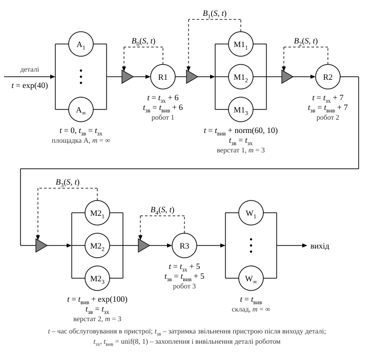

# Варіант 1. Закріплення роботів за маршрутами

Формалізований опис моделі засобами мережі масового обслуговування (МО). Кожен робот обслуговує лише свій шлях переміщення деталей. Робот бере деталь незалежно від стану верстата-приймача і займає місце на ньому лише в момент початку вивільнення. Якщо вільного місця немає, робот чекає біля верстата, тримаючи деталь (у програмі — режим `physical`).

## 1. Структура мережі

Запитом (вимогою) мережі є **деталь**. Мережа розімкнена: деталі надходять ззовні на пункт прибуття A і залишають мережу після вивільнення на складі W. Під час обслуговування деталь не знищується, не з'єднується з іншими деталями і не розпадається, тому процес можна описати мережею МО [1, с. 65].

**Роботи** є пристроями обслуговування. Кожен робот закріплений за одним маршрутом $S$ (табл. 1), тому йому відповідає окрема одноканальна СМО. **Верстат**, що одночасно обробляє до трьох деталей, є СМО з трьох ідентичних пристроїв (місць) без черги.

Таблиця 1 — Маршрути переміщення деталей

| Маршрут $S$ | Робот | Звідки, $src_S$ | Куди, $dst_S$ | Час переміщення $d_S$, с |
|:-:|:-:|:-:|:-:|:-:|
| 1 | R1 | пункт прибуття A | верстат M1 | 6 |
| 2 | R2 | верстат M1 | верстат M2 | 7 |
| 3 | R3 | верстат M2 | склад W | 5 |

Рисунок 1 — Мережа масового обслуговування, що представляє формалізовану модель ГВС (варіант 1)

Деталь проходить мережу послідовно: площадка A → R1 → M1 → R2 → M2 → R3 → склад. Площадка A є чергою СМО R1, тому з пристроєм R1 її з'єднує відрізок, а не дуга [2, табл. 3.1]. Під кожним роботом указано його часову затримку $t$; перший доданок у ній — повернення робота порожнім до точки завантаження (п. 3). Трикутники позначають блокування маршрутів $B_1$–$B_4$ (п. 5). Пунктирні лінії — керуючі зв'язки: вони ведуть від елемента, від стану якого залежить умова блокування.

## 2. Вхідні змінні та параметри

Таблиця 2 — Вхідні змінні та параметри моделі

| Позначення | Зміст | Значення |
|:-:|---|:-:|
| $\tau_A$ | інтервал між надходженнями деталей на площадку A, с | $\exp(40)$ |
| $t_{\text{обр}1}$ | час обробки деталі на верстаті M1, с | $\mathrm{norm}(60, 10)$ |
| $t_{\text{обр}2}$ | час обробки деталі на верстаті M2, с | $\exp(100)$ |
| $t_{\text{зх}}$ | час захоплення деталі роботом, с | $\mathrm{unif}(8, 1)$ |
| $t_{\text{вив}}$ | час вивільнення деталі роботом, с | $\mathrm{unif}(8, 1)$ |
| $d_1,\ d_2,\ d_3$ | час переміщення робота маршрутом 1, 2, 3 (однаковий з деталлю і порожнім), с | 6, 7, 5 |
| $m$ | кількість місць на кожному верстаті | 3 |
| $N_R$ | кількість роботів, по одному на маршрут | 3 |
| $max$ | кількість місць у черзі площадки A | не обмежена |

Позначення законів розподілу: $\exp(d)$ — експоненціальний із середнім $d$; $\mathrm{norm}(d, s)$ — нормальний із середнім $d$ і середнім квадратичним відхиленням $s$; $\mathrm{unif}(d, s)$ — рівномірний на інтервалі $(d - s,\ d + s)$, тобто $\mathrm{unif}(8, 1)$ означає $8 \pm 1$ с. Усі випадкові величини незалежні; $t_{\text{зх}}$ і $t_{\text{вив}}$ генеруються окремо для кожної дії робота.

Генератори випадкових величин ($\zeta$ — рівномірно розподілена на інтервалі $(0, 1)$ величина):

$$
\exp(d):\ x = -d\ln\zeta; \qquad \mathrm{unif}(d, s):\ x = d - s + 2s\zeta; \qquad \mathrm{norm}(d, s):\ x = d + s\,z,
$$

де $z$ — стандартна нормальна величина, отримана полярним методом Марсальї–Брея:

$$
v_1 = 2\zeta_1 - 1,\quad v_2 = 2\zeta_2 - 1,\quad w = v_1^2 + v_2^2,\quad z_{1,2} = v_{1,2}\sqrt{\frac{-2\ln w}{w}}.
$$

Пара $\zeta_1, \zeta_2$ генерується знову, доки не виконається умова $0 < w \le 1$; один розрахунок дає два значення $z$. Якщо $t_{\text{обр}1} \le 0$, значення генерується повторно, бо час обробки не може бути від'ємним.

## 3. Час обслуговування роботів

Обслуговування деталі роботом $\mathrm{R}_S$ складається з п'яти фаз (табл. 3). Після вивільнення робот залишається в точці вивантаження $dst_S$. Коли його займає наступна деталь, він повертається порожнім до точки завантаження $src_S$. **Цей рух назад (холостий хід) є першою фазою обслуговування.**

Таблиця 3 — Фази обслуговування деталі роботом $\mathrm{R}_S$

| Фаза | Дія робота | Тривалість | Де фізично деталь |
|:-:|---|:-:|---|
| 1 | холостий хід (повернення) $dst_S \to src_S$ | $d_S^{\text{хол}} = d_S$ | на площадці A або на місці верстата-джерела |
| 2 | захоплення деталі | $t_{\text{зх}}$ | там само; місце звільняється в кінці фази |
| 3 | переміщення з деталлю $src_S \to dst_S$ | $d_S$ | у захваті робота |
| 4 | блокування: очікування вільного місця на верстаті-приймачі (лише якщо $B = 1$) | $\tau_{\text{бл}} \ge 0$ | у захваті робота |
| 5 | вивільнення деталі | $t_{\text{вив}}$ | на місці верстата-приймача, яке вже зайняте (для R3 — на складі) |

Часова затримка пристрою $\mathrm{R}_S$ (час обслуговування без блокування):

$$
t_{\mathrm{R}_S} = \underbrace{d_S^{\text{хол}}}_{\text{повернення}} + \underbrace{t_{\text{зх}}}_{\text{захоплення}} + \underbrace{d_S}_{\text{з деталлю}} + \underbrace{t_{\text{вив}}}_{\text{вивільнення}},
$$

$$
\begin{cases}
t_{\mathrm{R1}} = 6 + t_{\text{зх}} + 6 + t_{\text{вив}}, & \bar t_{\mathrm{R1}} = 28 \text{ с},\\
t_{\mathrm{R2}} = 7 + t_{\text{зх}} + 7 + t_{\text{вив}}, & \bar t_{\mathrm{R2}} = 30 \text{ с},\\
t_{\mathrm{R3}} = 5 + t_{\text{зх}} + 5 + t_{\text{вив}}, & \bar t_{\mathrm{R3}} = 26 \text{ с},
\end{cases}
\qquad t_{\text{зх}},\ t_{\text{вив}} \sim \mathrm{unif}(8, 1),
$$

де $\bar t$ — середнє значення. Для першої деталі кожного робота $d_S^{\text{хол}} = 0$, бо в початковий момент робот уже стоїть у точці завантаження свого маршруту (п. 6).

Повний час, протягом якого робот зайнятий однією деталлю, дорівнює $t_{\mathrm{R}_S} + \tau_{\text{бл}}$. Час блокування $\tau_{\text{бл}}$ не задається законом розподілу: його визначає стан верстата-приймача (п. 5). Для R3 завжди $\tau_{\text{бл}} = 0$, бо склад приймає деталі без обмежень.

**Відображення руху робота назад.** Дуга мережі МО позначає маршрут слідування запиту, тобто деталі, а робот є пристроєм обслуговування [1, с. 64, 67]. Тому окремої дуги для руху робота немає. Повернення до точки завантаження входить у часову затримку пристрою як фаза 1, доданок $d_S^{\text{хол}}$. Так само в [1, рис. 3.34] порожній рейс самоскида входить у час його поїздки: ${45 = 22 + 5 + 18}$ хв.

## 4. Стан мережі

Стан мережі $S(t)$ у момент $t$ описують такі змінні:

- $q(t)$ — кількість деталей у черзі площадки A, які ще не почав обслуговувати робот R1;
- $K_{ij}(t)$ — стан $j$-го місця верстата $\mathrm{M}i$ $(i = 1, 2;\ j = 1, 2, 3)$: 0 — вільне; 1 — вивільнення (робот кладе деталь); 2 — обробка; 3 — заблоковане (оброблена деталь чекає на робота наступного маршруту); 4 — захоплення (робот знімає деталь);
- $K_{\mathrm{R}_S}(t)$ — стан робота $\mathrm{R}_S$: 0 — вільний; 1–5 — номер поточної фази з табл. 3;
- $pos_S$ — точка, у якій стоїть вільний робот $\mathrm{R}_S$: до першої деталі $pos_S = src_S$, далі завжди $pos_S = dst_S$; холостий хід $d_S^{\text{хол}} = d(pos_S, src_S)$.

Похідні величини:

$$
n_i(t) = \sum_{j=1}^{3} \mathbf{1}\{K_{ij}(t) \ne 0\}, \qquad L_A(t) = q(t) + \mathbf{1}\{K_{\mathrm{R1}}(t) \in \{1, 2\}\},
$$

де $\mathbf{1}\{P\} = 1$, якщо умова $P$ виконується, і $0$, якщо ні; $n_i(t)$ — кількість зайнятих місць верстата $\mathrm{M}i$; $L_A(t)$ — кількість деталей, що фізично лежать на площадці A. Деталь залишається на площадці, поки R1 їде по неї і захоплює її.

## 5. Умови блокування маршрутів

$$
\begin{aligned}
B_1(S, t) &= \mathbf{1}\{n_1(t) = 3\}, &\qquad B_2(S, t) &= \mathbf{1}\{K_{\mathrm{R2}}(t) \ne 0\},\\
B_3(S, t) &= \mathbf{1}\{n_2(t) = 3\}, &\qquad B_4(S, t) &= \mathbf{1}\{K_{\mathrm{R3}}(t) \ne 0\}.
\end{aligned}
$$

Маршрут закритий, якщо $B(S, t) = 1$, і відкритий, якщо $B(S, t) = 0$. Маршрут R3 → склад не блокується.

Таблиця 4 — Блокування маршрутів

| Умова | Маршрут | Маршрут закритий, якщо | Де чекає деталь | Блокування знімає подія |
|:-:|:-:|---|---|---|
| $B_1$ | R1 → M1 | усі 3 місця M1 зайняті | у пристрої R1: робот тримає деталь біля M1 (фаза 4) | R2 завершив захоплення деталі з M1 |
| $B_2$ | M1 → R2 | робот R2 зайнятий | на місці верстата M1 (стан 3) | R2 завершив вивільнення на M2 |
| $B_3$ | R2 → M2 | усі 3 місця M2 зайняті | у пристрої R2: робот тримає деталь біля M2 (фаза 4) | R3 завершив захоплення деталі з M2 |
| $B_4$ | M2 → R3 | робот R3 зайнятий | на місці верстата M2 (стан 3) | R3 завершив вивільнення на складі |

Пояснення до умов блокування:

1. $B_1$ і $B_3$ перевіряються в момент, коли робот із деталлю прибуває до верстата (кінець фази 3). Якщо вільне місце є, робот одразу починає вивільнення. Якщо немає, робот тримає деталь, доки місце не звільниться, і тоді одразу починає вивільнення.
2. Місце верстата зайняте, поки на ньому фізично лежить деталь: від початку вивільнення до кінця захоплення роботом наступного маршруту. Деталь, по яку робот уже їде, ще займає місце (стан 3, потім 4). Тому $n_i(t)$ враховує всі стани місця, крім 0.
3. Перед R2 і R3 черги немає: оброблена деталь лежить на місці верстата і займає його, а черга звільнила б місце. Тому використано блокування $B_2$ і $B_4$. Без них деталь, яка не застала робота вільним, отримала б відмову в обслуговуванні [2, с. 50].

## 6. Правила функціонування та початковий стан

1. Деталь, що надійшла, стає в кінець черги площадки A. Деталі з черги обслуговуються в порядку надходження (FIFO).
2. Вільний робот $\mathrm{R}_S$ починає обслуговування (фаза 1), щойно на початку його маршруту є деталь. Якщо на верстаті-джерелі на робота чекають кілька деталей, першою обслуговується та, що раніше завершила обробку.
3. Кінець фази 2 звільняє місце, з якого знято деталь: на площадці $L_A$ зменшується на 1, на верстаті $K_{ij} := 0$. Якщо біля цього верстата чекає заблокований робот, він одразу займає звільнене місце.
4. Вивільнення займає вільне місце з найменшим номером $(K_{ij} := 1)$. Після вивільнення починається обробка $(K_{ij} := 2)$, а робот стає вільним і стоїть у точці $dst_S$. Вивільнення на складі завершує проходження деталі: вона залишає мережу.
5. Після обробки місце переходить у стан 3 і чекає на робота наступного маршруту.
6. Події, які настають в один момент часу, обробляються у випадковому порядку, причому завершення обслуговування обробляються раніше за надходження нової деталі. Вільні роботи призначаються на деталі після обробки всіх подій цього моменту.

Початковий стан $(t = 0)$: $q = 0$; усі місця верстатів вільні $(K_{ij} = 0)$; роботи вільні й стоять у точках завантаження своїх маршрутів: R1 — у A, R2 — у M1, R3 — у M2. Перша деталь надходить у момент $\tau_{A,1}$.

## 7. Вихідні характеристики

Статистика збирається на інтервалі $[T_{\text{п}},\ T_{\text{mod}}]$ тривалістю $T = T_{\text{mod}} - T_{\text{п}}$, де $T_{\text{mod}}$ — час моделювання, $T_{\text{п}}$ — тривалість перехідного періоду. Інтеграли за часом обчислюються під час імітації як суми $\sum_k f(t_k)\,(t_{k+1} - t_k)$ за інтервалами між послідовними подіями.

Таблиця 5 — Вихідні характеристики моделі

| Характеристика | Формула обчислення |
|---|---|
| Пропускна здатність, дет./год | $\Lambda = 3600\, N_W / T$, де $N_W$ — кількість деталей, вивільнених на складі за час $T$ |
| Час проходження $i$-ї деталі, с | $\tau_i = t_i^{W} - t_i^{A}$: від надходження на площадку A до кінця вивільнення на складі |
| Середній час проходження і СКВ, с | $\bar\tau = \dfrac{1}{N_W}\sum_{i} \tau_i, \qquad s_\tau = \sqrt{\dfrac{1}{N_W - 1}\sum_{i} (\tau_i - \bar\tau)^2}$ |
| Розподіл часу проходження | гістограма відносних частот $h_k = N_k / N_W$, де $N_k$ — кількість значень $\tau_i$ у $k$-му інтервалі; відповідність закону розподілу перевіряється за критерієм $\chi^2$ |
| Коефіцієнт використання робота $\mathrm{R}_S$ | $\rho_{\mathrm{R}_S} = \dfrac{1}{T}\displaystyle\int_{T_{\text{п}}}^{T_{\text{mod}}} \mathbf{1}\{K_{\mathrm{R}_S}(t) \ne 0\}\,dt$ — разом із холостим ходом і блокуванням |
| Частка фази $k$ у часі роботи робота | $\rho_{\mathrm{R}_S}^{(k)} = \dfrac{1}{T}\displaystyle\int_{T_{\text{п}}}^{T_{\text{mod}}} \mathbf{1}\{K_{\mathrm{R}_S}(t) = k\}\,dt, \qquad \rho_{\mathrm{R}_S} = \sum_{k=1}^{5} \rho_{\mathrm{R}_S}^{(k)}$ |
| Коефіцієнт використання верстата $\mathrm{M}i$ | $\rho_{\mathrm{M}i} = \dfrac{1}{3T}\displaystyle\int_{T_{\text{п}}}^{T_{\text{mod}}} n_i(t)\,dt$ |
| Частка обробки на верстаті $\mathrm{M}i$ | $\rho^{\text{обр}}_{\mathrm{M}i} = \dfrac{1}{3T}\displaystyle\int_{T_{\text{п}}}^{T_{\text{mod}}} \sum_{j=1}^{3} \mathbf{1}\{K_{ij}(t) = 2\}\,dt$ |
| Частка блокування верстата $\mathrm{M}i$ (оброблена деталь чекає на робота) | $\rho^{\text{бл}}_{\mathrm{M}i} = \dfrac{1}{3T}\displaystyle\int_{T_{\text{п}}}^{T_{\text{mod}}} \sum_{j=1}^{3} \mathbf{1}\{K_{ij}(t) = 3\}\,dt$ |
| Максимальна місткість місця зберігання на ділянці прибуття | $L_{max} = \max\limits_{t \in [T_{\text{п}},\ T_{\text{mod}}]} L_A(t)$ |
| Середня кількість деталей на площадці A | $\bar L_A = \dfrac{1}{T}\displaystyle\int_{T_{\text{п}}}^{T_{\text{mod}}} L_A(t)\,dt$ |

## 8. Вимоги до точності

Кожна вихідна характеристика оцінюється як середнє $\bar x$ за серією з $p$ незалежних прогонів моделі з різними початковими значеннями генераторів. Кількість прогонів визначається за нерівністю Чебишова:

$$
p = \frac{\sigma^2}{\varepsilon^2 (1 - \beta)}, \qquad \beta = 0{,}95 \;\Rightarrow\; p = 20\left(\frac{\sigma}{\varepsilon}\right)^2,
$$

де $\sigma$ — середнє квадратичне відхилення характеристики за пілотною серією з 20 прогонів; ${\varepsilon = 0{,}02\,\bar x}$ — допустима похибка (2 % від середнього значення); $\beta$ — довірча ймовірність.

## Джерела

1. Стеценко І. В. Моделювання систем : навчальний посібник.
2. Методичні вказівки до виконання курсової роботи з дисципліни «Моделювання систем».
