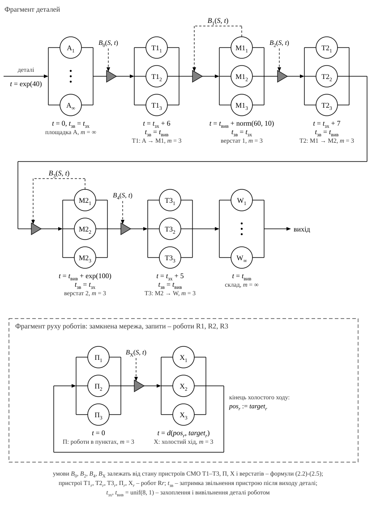

# Варіант 2. Спільна СМО роботів: найближчий вільний робот

Формалізований опис моделі засобами мережі масового обслуговування (МО). Будь-який робот може виконувати будь-яке перевезення деталі, і на кожне перевезення призначається найближчий з вільних роботів. Як і у варіанті 1, робот може взяти деталь, навіть якщо на верстаті-приймачі немає вільного місця, і займає місце на ньому лише в момент початку вивільнення. Якщо вільного місця немає, робот чекає біля верстата, тримаючи деталь (у програмі — стратегія `nearest`, режим `physical`). Щоб роботи не заблокували один одного, до верстата одночасно можуть їхати не більше роботів, ніж на ньому вільних місць, плюс один (п. 5).

## 1. Структура мережі

Запитом (вимогою) мережі, як і у варіанті 1, є **деталь**. Мережа розімкнена: деталі надходять ззовні на пункт прибуття A і залишають мережу після вивільнення на складі W. Під час обслуговування деталь не знищується, не з'єднується з іншими деталями і не розпадається, тому процес можна описати мережею МО [1, с. 65].

**Роботи** утворюють одну триканальну СМО R з пристроями R1, R2, R3: будь-який вільний робот може обслужити будь-яку деталь. Деталь проходить СМО R тричі, по одному разу на кожному маршруті $S$ (табл. 1). Номер маршруту, яким деталь треба перевезти, є **типом вимоги** $S$. Від типу залежать місце, звідки деталь надходить у СМО R, час її обслуговування і маршрут після СМО R. Саме в таких випадках у мережу МО вводять кілька типів вимог [1, с. 63]. Деталь надходить на площадку A з типом $S = 1$, після обробки на M1 отримує тип $S = 2$, після обробки на M2 — тип $S = 3$.

**Верстат**, як і у варіанті 1, є СМО з трьох ідентичних пристроїв (місць) без черги.

Рисунок 1 — Мережа масового обслуговування, що представляє формалізовану модель ГВС (варіант 2)

Деталь проходить мережу так: площадка A → R ($S = 1$) → M1 → R ($S = 2$) → M2 → R ($S = 3$) → склад. Площадка A є чергою СМО R, тому з пристроями її з'єднує відрізок, а не дуга [2, табл. 3.1]. У цій черзі чекають лише деталі типу 1. Деталі типів 2 і 3 після обробки лишаються на місцях верстатів і надходять у СМО R дугами M1 → R і M2 → R, минаючи чергу.

Дуги M1 → R і M2 → R позначають маршрут деталі, а не рух робота. Після обробки деталь знову потребує перевезення і повертається в ту саму СМО роботів, так само як вимога на рис. 3.3 [1] повертається на доробку. Рух робота порожнім входить у його часову затримку (п. 3).

На виході СМО R маршрут розгалужується за типом вимоги: $S = 1$ — на M1, $S = 2$ — на M2, $S = 3$ — на склад. Гілку тут однозначно визначає тип деталі, а не ймовірність, як у розгалуженні з [2, табл. 3.1].

Трикутники позначають блокування маршрутів $B_0$–$B_4$ (п. 5). Блокування $B_1$ і $B_3$ залежать від стану верстатів, як у варіанті 1. Умови $B_0$, $B_2$, $B_4$ на входах СМО R задає **керування роботами** — правило призначення найближчого вільного робота (п. 6). Його керуючий зв'язок (пунктир) проходить через усі три трикутники, як «керування рухом» на рис. 3.30 [1], де одне джерело керує двома блокуваннями. На тому самому рисунку блокування стоїть між чергою і пристроєм, як $B_0$ на рис. 1.

Таблиця 1 — Маршрути переміщення деталей (типи вимог)

| Маршрут (тип) $S$ | Звідки, $src_S$ | Куди, $dst_S$ | Час переміщення $d_S$, с | Де деталь чекає на робота |
|:-:|:-:|:-:|:-:|:-:|
| 1 | пункт прибуття A | верстат M1 | 6 | у черзі площадки A |
| 2 | верстат M1 | верстат M2 | 7 | на місці верстата M1 |
| 3 | верстат M2 | склад W | 5 | на місці верстата M2 |

## 2. Вхідні змінні та параметри

Таблиця 2 — Вхідні змінні та параметри моделі

| Позначення | Зміст | Значення |
|:-:|---|:-:|
| $\tau_A$ | інтервал між надходженнями деталей на площадку A, с | $\exp(40)$ |
| $t_{\text{обр}1}$ | час обробки деталі на верстаті M1, с | $\mathrm{norm}(60, 10)$ |
| $t_{\text{обр}2}$ | час обробки деталі на верстаті M2, с | $\exp(100)$ |
| $t_{\text{зх}}$ | час захоплення деталі роботом, с | $\mathrm{unif}(8, 1)$ |
| $t_{\text{вив}}$ | час вивільнення деталі роботом, с | $\mathrm{unif}(8, 1)$ |
| $d(a, b)$ | час переміщення робота між точками $a, b \in \{\mathrm{A}, \mathrm{M1}, \mathrm{M2}, \mathrm{W}\}$, однаковий з деталлю і порожнім, с | матриця $D$ |
| $d_1,\ d_2,\ d_3$ | час переміщення з деталлю маршрутом 1, 2, 3: $d_S = d(src_S, dst_S)$, с | 6, 7, 5 |
| $m$ | кількість місць на кожному верстаті | 3 |
| $N_R$ | кількість роботів у спільній СМО R | 3 |
| $max$ | кількість місць у черзі площадки A | не обмежена |
| $\rho_1,\ \rho_2,\ \rho_3$ | пріоритет маршруту 1, 2, 3 при однаковій відстані до робота (менше значення — вищий пріоритет) | 3, 2, 1 |

Пункти розташовані на одній лінії A – M1 – M2 – W, тому час переміщення між несусідніми пунктами дорівнює сумі часів між сусідніми: $d(\mathrm{A}, \mathrm{M2}) = 6 + 7 = 13$, $d(\mathrm{M1}, \mathrm{W}) = 7 + 5 = 12$, $d(\mathrm{A}, \mathrm{W}) = 18$ с. Повна матриця часів переміщення:

$$
D = \begin{array}{c|cccc}
 & \mathrm{A} & \mathrm{M1} & \mathrm{M2} & \mathrm{W} \\ \hline
\mathrm{A} & 0 & 6 & 13 & 18 \\
\mathrm{M1} & 6 & 0 & 7 & 12 \\
\mathrm{M2} & 13 & 7 & 0 & 5 \\
\mathrm{W} & 18 & 12 & 5 & 0
\end{array}
$$

Пріоритет $\rho_S$ означає, що при однаковій відстані першими вивозяться деталі, ближчі до складу: так швидше звільняються місця на верстатах.

Позначення законів розподілу: $\exp(d)$ — експоненціальний із середнім $d$; $\mathrm{norm}(d, s)$ — нормальний із середнім $d$ і середнім квадратичним відхиленням $s$; $\mathrm{unif}(d, s)$ — рівномірний на інтервалі $(d - s,\ d + s)$, тобто $\mathrm{unif}(8, 1)$ означає $8 \pm 1$ с. Усі випадкові величини незалежні; $t_{\text{зх}}$ і $t_{\text{вив}}$ генеруються окремо для кожної дії робота.

Генератори випадкових величин ($\zeta$ — рівномірно розподілена на інтервалі $(0, 1)$ величина):

$$
\exp(d):\ x = -d\ln\zeta; \qquad \mathrm{unif}(d, s):\ x = d - s + 2s\zeta; \qquad \mathrm{norm}(d, s):\ x = d + s\,z,
$$

де $z$ — стандартна нормальна величина, отримана полярним методом Марсальї–Брея:

$$
v_1 = 2\zeta_1 - 1,\quad v_2 = 2\zeta_2 - 1,\quad w = v_1^2 + v_2^2,\quad z_{1,2} = v_{1,2}\sqrt{\frac{-2\ln w}{w}}.
$$

Пара $\zeta_1, \zeta_2$ генерується знову, доки не виконається умова $0 < w \le 1$; один розрахунок дає два значення $z$. Якщо $t_{\text{обр}1} \le 0$, значення генерується повторно, бо час обробки не може бути від'ємним.

## 3. Час обслуговування роботів

Обслуговування деталі типу $S$ роботом $r$ складається з тих самих п'яти фаз, що й у варіанті 1 (табл. 3). Відрізняється лише фаза 1. Робот їде порожнім до точки завантаження $src_S$ з тієї точки $pos_r$, де він вивільнив попередню деталь. Ця точка залежить від того, яке перевезення робот виконував останнім.

Таблиця 3 — Фази обслуговування деталі типу $S$ роботом $r$

| Фаза | Дія робота | Тривалість | Де фізично деталь |
|:-:|---|:-:|---|
| 1 | холостий хід $pos_r \to src_S$ | $d(pos_r, src_S)$ | на площадці A або на місці верстата-джерела |
| 2 | захоплення деталі | $t_{\text{зх}}$ | там само; місце звільняється в кінці фази |
| 3 | переміщення з деталлю $src_S \to dst_S$ | $d_S$ | у захваті робота |
| 4 | блокування: очікування вільного місця на верстаті-приймачі (лише якщо $B = 1$) | $\tau_{\text{бл}} \ge 0$ | у захваті робота |
| 5 | вивільнення деталі | $t_{\text{вив}}$ | на місці верстата-приймача, яке вже зайняте (для $S = 3$ — на складі) |

Часова затримка пристрою СМО R (час обслуговування деталі типу $S$ роботом $r$ без блокування):

$$
t_{\mathrm{R}}(S, r) = \underbrace{d(pos_r, src_S)}_{\text{холостий хід}} + \underbrace{t_{\text{зх}}}_{\text{захоплення}} + \underbrace{d_S}_{\text{з деталлю}} + \underbrace{t_{\text{вив}}}_{\text{вивільнення}}, \qquad t_{\text{зх}},\ t_{\text{вив}} \sim \mathrm{unif}(8, 1).
$$

Холостий хід береться з матриці $D$ (табл. 4). Після вивільнення робот стоїть у точці $dst_S$ свого останнього маршруту, тому $pos_r \in \{\mathrm{M1}, \mathrm{M2}, \mathrm{W}\}$. Точка A можлива лише на початку моделювання, для R1 (п. 6).

Таблиця 4 — Тривалість холостого ходу $d(pos_r, src_S)$, с

| Де стоїть робот, $pos_r$ | $S = 1$ (до A) | $S = 2$ (до M1) | $S = 3$ (до M2) |
|:-:|:-:|:-:|:-:|
| A (лише R1 на початку) | 0 | 6 | 13 |
| M1 | 6 | 0 | 7 |
| M2 | 13 | 7 | 0 |
| W | 18 | 12 | 5 |

Межі часу обслуговування для кожного типу деталі:

$$
\begin{cases}
t_{\mathrm{R}}(1, r) = d(pos_r, \mathrm{A}) + t_{\text{зх}} + 6 + t_{\text{вив}}, & 20 < t_{\mathrm{R}}(1, r) < 42 \text{ с},\\
t_{\mathrm{R}}(2, r) = d(pos_r, \mathrm{M1}) + t_{\text{зх}} + 7 + t_{\text{вив}}, & 21 < t_{\mathrm{R}}(2, r) < 37 \text{ с},\\
t_{\mathrm{R}}(3, r) = d(pos_r, \mathrm{M2}) + t_{\text{зх}} + 5 + t_{\text{вив}}, & 19 < t_{\mathrm{R}}(3, r) < 36 \text{ с}.
\end{cases}
$$

Найменші значення — коли робот уже стоїть у точці завантаження і холостого ходу немає. Наприклад, робот, що вивільнив деталь на M2, одразу забирає з M2 оброблену деталь на склад. У варіанті 1 такого не буває: закріплений робот повертається своїм маршрутом, тому там $d(pos_r, src_S) = d_S$ для всіх деталей, крім першої. Отже, варіант 1 є окремим випадком цієї формули. Середнє значення $t_{\mathrm{R}}(S, r)$ заздалегідь невідоме, бо воно залежить від того, де стоять вільні роботи в момент призначення. Його оцінюють за результатами імітації через частку фази 1 у часі роботи роботів (табл. 6).

Повний час, протягом якого робот зайнятий однією деталлю, дорівнює $t_{\mathrm{R}}(S, r) + \tau_{\text{бл}}$. Час блокування $\tau_{\text{бл}}$ визначає стан верстата-приймача (п. 5). Для $S = 3$ завжди $\tau_{\text{бл}} = 0$, бо склад приймає деталі без обмежень.

**Відображення руху робота назад.** Як і у варіанті 1, окремої дуги для руху робота немає: дуга мережі МО позначає маршрут деталі, а робот є пристроєм обслуговування [1, с. 64, 67]. Рух робота порожнім є фазою 1 і входить у часову затримку пристрою доданком $d(pos_r, src_S)$.

## 4. Стан мережі

Стан мережі $S(t)$ у момент $t$ описують такі змінні:

- $q_S(t)$ — кількість деталей типу $S$, на які ще не призначено робота: $q_1$ — у черзі площадки A, $q_2$ — оброблені деталі на місцях M1, $q_3$ — оброблені деталі на місцях M2;
- $K_{ij}(t)$ — стан $j$-го місця верстата $\mathrm{M}i$ $(i = 1, 2;\ j = 1, 2, 3)$: 0 — вільне; 1 — вивільнення (робот кладе деталь); 2 — обробка; 3 — заблоковане (оброблена деталь чекає на робота); 4 — захоплення (робот знімає деталь);
- $K_r(t)$ — стан робота $r$ $(r = 1, 2, 3)$: 0 — вільний; 1–5 — номер поточної фази з табл. 3;
- $S_r(t)$ — тип деталі, яку обслуговує робот $r$ (визначений, якщо $K_r(t) \ne 0$);
- $pos_r(t)$ — точка, у якій стоїть вільний робот $r$: на початку R1 — A, R2 — M1, R3 — M2; після вивільнення $pos_r = dst_{S_r}$.

Похідні величини:

$$
n_i(t) = \sum_{j=1}^{3} \mathbf{1}\{K_{ij}(t) \ne 0\}, \qquad f_i(t) = 3 - n_i(t), \qquad N_{\text{віл}}(t) = \sum_{r=1}^{3} \mathbf{1}\{K_r(t) = 0\},
$$

$$
u_i(t) = \sum_{r=1}^{3} \mathbf{1}\{S_r(t) = i,\ K_r(t) \in \{1, 2, 3, 4\}\}, \qquad L_A(t) = q_1(t) + \sum_{r=1}^{3} \mathbf{1}\{S_r(t) = 1,\ K_r(t) \in \{1, 2\}\},
$$

де $\mathbf{1}\{P\} = 1$, якщо умова $P$ виконується, і $0$, якщо ні; $n_i(t)$ і $f_i(t)$ — кількість зайнятих і вільних місць верстата $\mathrm{M}i$; $N_{\text{віл}}(t)$ — кількість вільних роботів. Величина $u_i(t)$ $(i = 1, 2)$ — кількість роботів, призначених доставити деталь на верстат $\mathrm{M}i$, які ще не зайняли на ньому місця: вони їдуть по деталь, захоплюють її, везуть або чекають з нею біля верстата. Деталь типу $S$ везуть на верстат $\mathrm{M}S$, тому для $u_i$ рахуються роботи з $S_r = i$. $L_A(t)$ — кількість деталей, що фізично лежать на площадці A: деталь залишається на площадці, поки робот їде по неї і захоплює її.

## 5. Умови блокування маршрутів

$$
\begin{aligned}
B_0(S, t) &= \mathbf{1}\{u_1(t) > f_1(t)\}, &\qquad B_1(S, t) &= \mathbf{1}\{n_1(t) = 3\},\\
B_2(S, t) &= \mathbf{1}\{N_{\text{віл}}(t) = 0\ \lor\ u_2(t) > f_2(t)\}, &\qquad B_3(S, t) &= \mathbf{1}\{n_2(t) = 3\},\\
B_4(S, t) &= \mathbf{1}\{N_{\text{віл}}(t) = 0\}.
\end{aligned}
$$

Маршрут закритий, якщо $B(S, t) = 1$, і відкритий, якщо $B(S, t) = 0$. Маршрут R → склад не блокується. $B_0$, $B_2$ і $B_4$ стоять на входах СМО R. Відкритий вхід дозволяє деталі зайняти вільного робота. Якщо на відкритих входах деталей більше, ніж вільних роботів, порядок визначає правило вибору робота (п. 6).

Таблиця 5 — Блокування маршрутів

| Умова | Маршрут | Маршрут закритий, якщо | Де чекає деталь | Блокування знімає подія |
|:-:|:-:|---|---|---|
| $B_0$ | A → R, $S = 1$ | до M1 уже призначено на одного робота більше, ніж там вільних місць: $u_1 > f_1$ | у черзі площадки A | робот завершив захоплення деталі з M1 |
| $B_1$ | R → M1 | усі 3 місця M1 зайняті | у пристрої R: робот тримає деталь біля M1 (фаза 4) | робот завершив захоплення деталі з M1 |
| $B_2$ | M1 → R, $S = 2$ | усі роботи зайняті або до M2 уже призначено на одного робота більше, ніж там вільних місць: $u_2 > f_2$ | на місці верстата M1 (стан 3) | кінець вивільнення (звільнився робот) або кінець захоплення деталі з M2 (звільнилося місце) |
| $B_3$ | R → M2 | усі 3 місця M2 зайняті | у пристрої R: робот тримає деталь біля M2 (фаза 4) | робот завершив захоплення деталі з M2 |
| $B_4$ | M2 → R, $S = 3$ | усі роботи зайняті | на місці верстата M2 (стан 3) | будь-який робот завершив вивільнення |

Пояснення до умов блокування:

1. $B_1$ і $B_3$ перевіряються в момент, коли робот із деталлю прибуває до верстата (кінець фази 3). Якщо вільне місце є, робот одразу починає вивільнення. Якщо немає, робот тримає деталь, доки місце не звільниться, і тоді одразу починає вивільнення.
2. Місце верстата зайняте, поки на ньому фізично лежить деталь: від початку вивільнення до кінця захоплення роботом. Деталь, по яку робот уже їде, ще займає місце (стан 3, потім 4). Тому $n_i(t)$ враховує всі стани місця, крім 0.
3. Оброблена деталь лежить на місці верстата і займає його. Тому вона не може стати в чергу СМО R: черга звільнила б місце. Замість черги використано блокування $B_2$ і $B_4$. Без них деталь, яка не застала вільного робота, отримала б відмову в обслуговуванні [2, с. 50].
4. **Не більше одного «зайвого» робота на верстат** ($B_0$ і друга частина $B_2$). Робот, який привіз деталь до заповненого верстата, тримає її і не може виконувати інших перевезень. У варіанті 1 до кожного верстата їздить лише свій робот, тому біля верстата чекає щонайбільше один робот. У варіанті 2 без обмеження всі три роботи можуть узяти деталі для одного заповненого верстата і стати біля нього. Тоді оброблені деталі на цьому верстаті чекають на вільного робота, якого вже немає, і виникає взаємне блокування: система зупиняється назавжди.
5. Умова $u_i \le f_i$ перевіряється в момент призначення, тому завжди $u_i \le f_i + 1$, тобто біля кожного верстата чекає не більше одного робота. Отже, заблокованими можуть бути щонайбільше два роботи, по одному біля M1 і M2. Третій робот заблокуватися не може: щойно на M2 з'явиться оброблена деталь, він вивезе її на склад, бо цей маршрут не блокується. Місце на M2 звільниться, і рух відновиться. Перевірка на програмі (5 прогонів по 200 000 с): без цього правила остання деталь потрапляла на склад на 320–1172-й секунді, після чого всі три роботи стояли з деталями біля заповнених верстатів. З правилом система в усіх прогонах працювала до кінця моделювання.

## 6. Правила функціонування та початковий стан

**Правило вибору робота (керування роботами).** Правило, за яким вимога обирає один з вільних пристроїв, задається відповідно до реальної системи [1, с. 63]. За умовою задачі це найближчий робот. Після обробки всіх подій поточного моменту вільні роботи призначаються на деталі, що чекають. Допустимі пари «робот — тип деталі»:

$$
P(t) = \bigl\{(r, S) :\ K_r(t) = 0,\ \ q_S(t) > 0,\ \ B_{\text{вх}}(S, t) = 0\bigr\}, \qquad B_{\text{вх}}(1, t) = B_0,\ \ B_{\text{вх}}(2, t) = B_2,\ \ B_{\text{вх}}(3, t) = B_4.
$$

З множини $P(t)$ обирається пара з найменшим значенням критеріїв, які порівнюються по черзі:

$$
(r^*, S^*) = \arg\min_{(r, S) \in P(t)} \bigl(d(pos_r, src_S),\ \rho_S,\ t^{\text{гот}}_S,\ \xi\bigr).
$$

Спочатку порівнюється відстань холостого ходу, тобто обирається найближчий робот. При рівній відстані перевагу має маршрут, ближчий до складу ($\rho_S$), далі деталь, яка чекає довше ($t^{\text{гот}}_S$ — момент, коли перша з деталей типу $S$, що чекають, стала готова до перевезення), далі вирішує випадковий вибір ($\xi$ — рівномірно розподілена на $(0, 1)$ величина). Робот $r^*$ починає фазу 1 для деталі типу $S^*$, яка раніше за інших стала готова до перевезення. Якщо $d(pos_{r^*}, src_{S^*}) = 0$, робот одразу починає захоплення. Після кожного призначення змінюються $N_{\text{віл}}$, $u_i$ і $q_S$, і вибір повторюється, доки $P(t)$ не стане порожньою.

Решта правил:

1. Деталь, що надійшла, стає в кінець черги площадки A як вимога типу 1 $(q_1 := q_1 + 1)$. Деталі одного типу обслуговуються в порядку готовності (FIFO): з площадки — у порядку надходження, з верстата — у порядку завершення обробки.
2. Після обробки на верстаті $\mathrm{M}i$ місце переходить у стан 3, а деталь стає вимогою типу $S = i + 1$ і чекає на робота на цьому місці $(q_{i+1} := q_{i+1} + 1)$.
3. Кінець фази 2 звільняє місце, з якого знято деталь: на площадці $L_A$ зменшується на 1, на верстаті $K_{ij} := 0$. Якщо біля цього верстата чекає заблокований робот, він одразу займає звільнене місце.
4. Вивільнення займає вільне місце з найменшим номером $(K_{ij} := 1)$. Після вивільнення починається обробка $(K_{ij} := 2)$, а робот стає вільним і стоїть у точці $dst_S$ $(pos_r := dst_S)$. Вивільнення на складі завершує проходження деталі: вона залишає мережу.
5. Події, які настають в один момент часу, обробляються у випадковому порядку, причому завершення обслуговування обробляються раніше за надходження нової деталі. Вільні роботи призначаються на деталі після обробки всіх подій цього моменту.

Початковий стан $(t = 0)$: $q_1 = q_2 = q_3 = 0$; усі місця верстатів вільні $(K_{ij} = 0)$; $u_1 = u_2 = 0$; роботи вільні й стоять там само, що й у варіанті 1: R1 — у A, R2 — у M1, R3 — у M2. Однаковий початковий стан потрібен, щоб варіанти порівнювалися за рівних умов. Перша деталь надходить у момент $\tau_{A,1}$.

## 7. Вихідні характеристики

Статистика збирається на інтервалі $[T_{\text{п}},\ T_{\text{mod}}]$ тривалістю $T = T_{\text{mod}} - T_{\text{п}}$, де $T_{\text{mod}}$ — час моделювання, $T_{\text{п}}$ — тривалість перехідного періоду. Інтеграли за часом обчислюються під час імітації як суми $\sum_k f(t_k)\,(t_{k+1} - t_k)$ за інтервалами між послідовними подіями.

Таблиця 6 — Вихідні характеристики моделі

| Характеристика | Формула обчислення |
|---|---|
| Пропускна здатність, дет./год | $\Lambda = 3600\, N_W / T$, де $N_W$ — кількість деталей, вивільнених на складі за час $T$ |
| Час проходження $i$-ї деталі, с | $\tau_i = t_i^{W} - t_i^{A}$: від надходження на площадку A до кінця вивільнення на складі |
| Середній час проходження і СКВ, с | $\bar\tau = \dfrac{1}{N_W}\sum_{i} \tau_i, \qquad s_\tau = \sqrt{\dfrac{1}{N_W - 1}\sum_{i} (\tau_i - \bar\tau)^2}$ |
| Розподіл часу проходження | гістограма відносних частот $h_k = N_k / N_W$, де $N_k$ — кількість значень $\tau_i$ у $k$-му інтервалі; відповідність закону розподілу перевіряється за критерієм $\chi^2$ |
| Коефіцієнт використання робота $r$ | $\rho_r = \dfrac{1}{T}\displaystyle\int_{T_{\text{п}}}^{T_{\text{mod}}} \mathbf{1}\{K_r(t) \ne 0\}\,dt$ — разом із холостим ходом і блокуванням |
| Середній коефіцієнт використання роботів | $\bar\rho_{\mathrm{R}} = \dfrac{1}{3}\displaystyle\sum_{r=1}^{3} \rho_r$ |
| Частка фази $k$ у часі роботи робота | $\rho_r^{(k)} = \dfrac{1}{T}\displaystyle\int_{T_{\text{п}}}^{T_{\text{mod}}} \mathbf{1}\{K_r(t) = k\}\,dt, \qquad \rho_r = \sum_{k=1}^{5} \rho_r^{(k)}$ |
| Кількість перевезень робота $r$ маршрутом $S$ | $N_{rS}$ — кількість призначень робота $r$ на деталі типу $S$ за час $T$ |
| Коефіцієнт використання верстата $\mathrm{M}i$ | $\rho_{\mathrm{M}i} = \dfrac{1}{3T}\displaystyle\int_{T_{\text{п}}}^{T_{\text{mod}}} n_i(t)\,dt$ |
| Частка обробки на верстаті $\mathrm{M}i$ | $\rho^{\text{обр}}_{\mathrm{M}i} = \dfrac{1}{3T}\displaystyle\int_{T_{\text{п}}}^{T_{\text{mod}}} \sum_{j=1}^{3} \mathbf{1}\{K_{ij}(t) = 2\}\,dt$ |
| Частка блокування верстата $\mathrm{M}i$ (оброблена деталь чекає на робота) | $\rho^{\text{бл}}_{\mathrm{M}i} = \dfrac{1}{3T}\displaystyle\int_{T_{\text{п}}}^{T_{\text{mod}}} \sum_{j=1}^{3} \mathbf{1}\{K_{ij}(t) = 3\}\,dt$ |
| Максимальна місткість місця зберігання на ділянці прибуття | $L_{max} = \max\limits_{t \in [T_{\text{п}},\ T_{\text{mod}}]} L_A(t)$ |
| Середня кількість деталей на площадці A | $\bar L_A = \dfrac{1}{T}\displaystyle\int_{T_{\text{п}}}^{T_{\text{mod}}} L_A(t)\,dt$ |

## 8. Вимоги до точності

Кожна вихідна характеристика оцінюється як середнє $\bar x$ за серією з $p$ незалежних прогонів моделі з різними початковими значеннями генераторів. Кількість прогонів визначається за нерівністю Чебишова:

$$
p = \frac{\sigma^2}{\varepsilon^2 (1 - \beta)}, \qquad \beta = 0{,}95 \;\Rightarrow\; p = 20\left(\frac{\sigma}{\varepsilon}\right)^2,
$$

де $\sigma$ — середнє квадратичне відхилення характеристики за пілотною серією з 20 прогонів; ${\varepsilon = 0{,}02\,\bar x}$ — допустима похибка (2 % від середнього значення); $\beta$ — довірча ймовірність. Варіанти 1 і 2 порівнюються за однакових вхідних змінних, тривалості прогонів і перехідного періоду та з однаковими початковими значеннями генераторів у відповідних прогонах.

## Джерела

1. Стеценко І. В. Моделювання систем : навчальний посібник.
2. Методичні вказівки до виконання курсової роботи з дисципліни «Моделювання систем».
